<figure class="photo wide">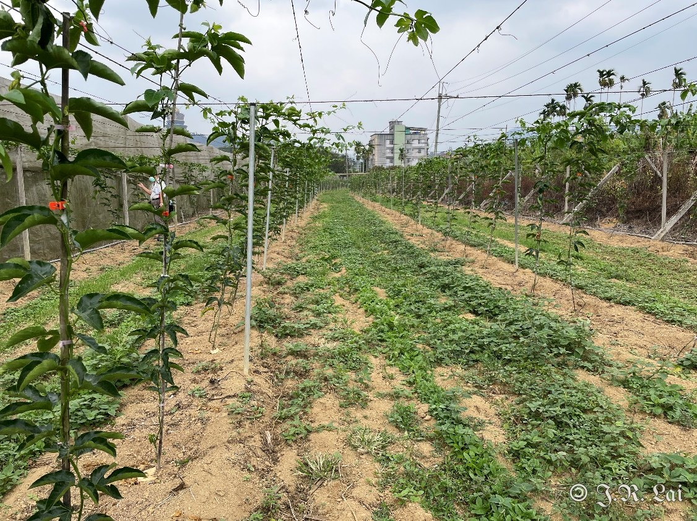<figcaption>圖一、露天栽培的百香果園</figcaption></figure>

本次調查埔里四處百香果園。同一天就看到蟲害、病害、生理障礙和物理傷害四種狀況，其中「葉片皺縮」在不同園區的原因完全不同，是很好的對照。

## 第一區：熱潛蠅與炭疽病

<figure class="photo">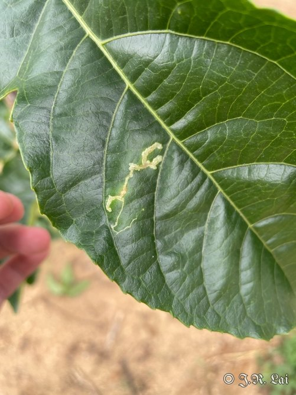<figcaption>熱潛蠅幼蟲在葉片留下的蛇行潛道</figcaption></figure>
<figure class="photo">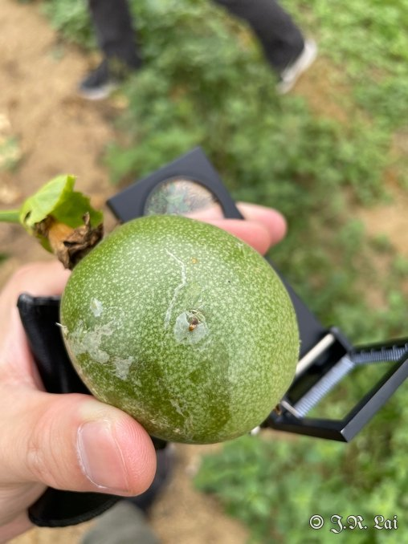<figcaption>以放大鏡檢查果實表面的蛀食痕跡</figcaption></figure>
<figure class="photo">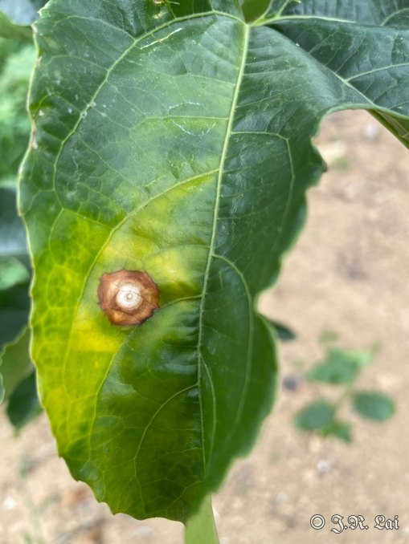<figcaption>葉片同心輪紋病斑，外圍有黃暈：炭疽病</figcaption></figure>

露天栽培，危害集中在部分區域。葉片和果實表面有明顯的蛀食潛道，果表也找到蛹的痕跡，判斷為百香果熱潛蠅（*Tropicomyia passiflorella*）；葉片另有同心輪紋、外圍黃暈的病斑，為炭疽病。

## 第二區：果實畸形

<figure class="photo">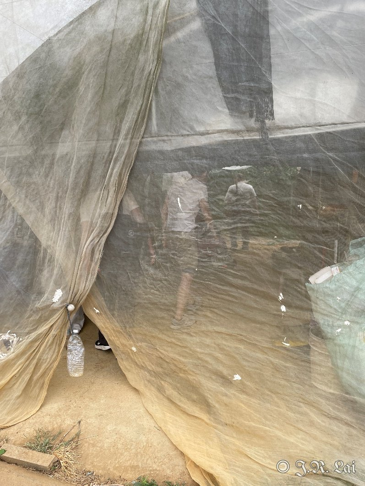<figcaption>網室栽培</figcaption></figure>
<figure class="photo">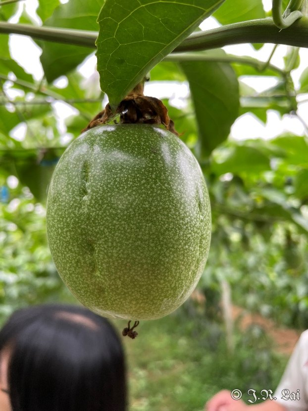<figcaption>果實畸形凹陷</figcaption></figure>
<figure class="photo">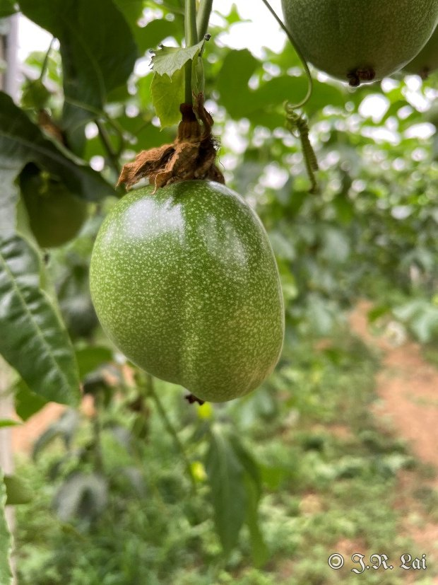<figcaption>果實畸形凹陷</figcaption></figure>

網室栽培，只有零星植株的果實畸形凹陷。種植時期遇到低溫，植株生長受阻，判斷為低溫生理障礙，不是病蟲害。

## 第三區：整株葉片皺縮

<figure class="photo">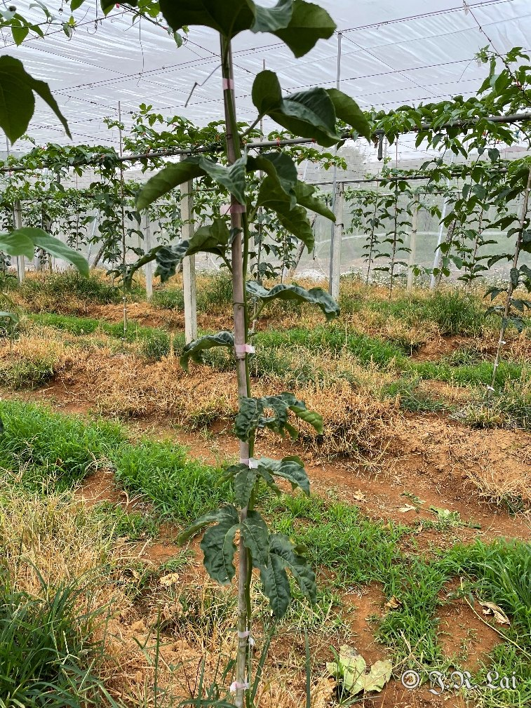<figcaption>植株葉片畸形皺縮</figcaption></figure>

零星植株整株葉片畸形皺縮。以放大鏡檢查葉片，沒有發現葉蟎等小型害蟲；而且是整株出現、不是局部，因此排除生理障礙，較可能是病毒病害。

## 第四區：靠著水管的葉片皺縮

<figure class="photo">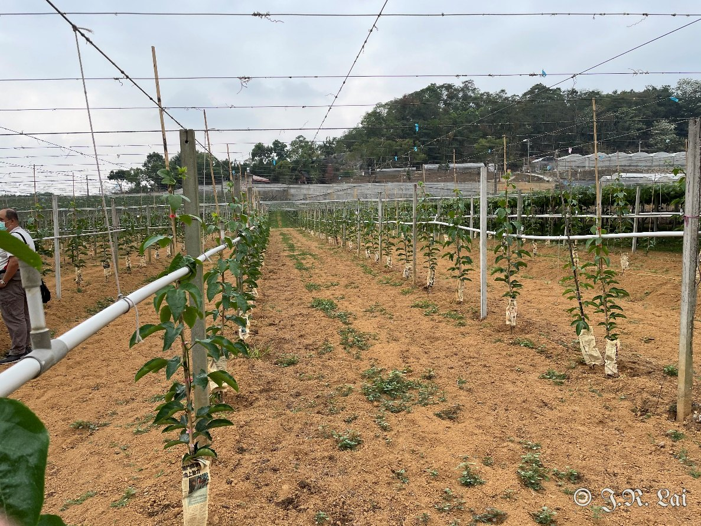<figcaption>第四區園區</figcaption></figure>
<figure class="photo">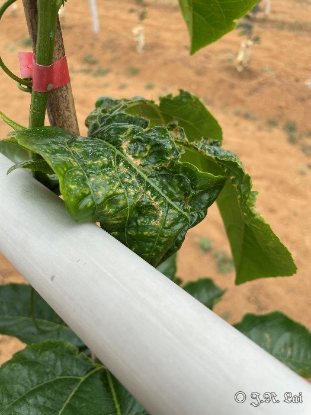<figcaption>緊靠水管的葉片皺縮</figcaption></figure>
<figure class="photo">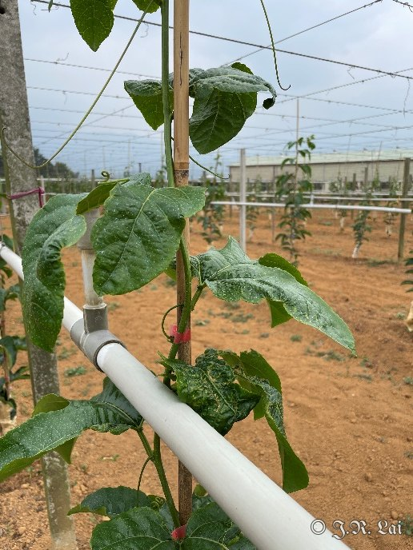<figcaption>沒有靠著水管的部分生長正常</figcaption></figure>

葉片皺縮只出現在靠著水管的枝蔓，沒有靠著水管的部分都正常。這是風吹時葉片和水管磨擦造成的物理傷害，不需要用藥。

## 診斷結果

第一區為百香果熱潛蠅與炭疽病，第二區為低溫生理障礙，第三區疑似病毒病害，第四區為物理性磨擦傷害。

## 建議處理

**熱潛蠅**

- 化學防治：三落松（1B）、賽滅淨（17）
- 田間管理：清除雜草、清園，摘除受害葉片
- 物理防治：懸掛黃色黏板，降低成蟲密度

**炭疽病**

- 化學防治：甲基多保淨（1）、得克利（3）、三氟敏（11）、百克敏（11）、亞托敏（11）、扶吉胺（29）、免得爛（M3）、克熱淨（M7）、亞托待克利（3+11）、三氟派瑞（7+11）、賽普護汰寧（9+12）
- 田間管理：清除罹病組織，維持園區通風和日照
- 培肥管理：合理化施肥，高溫季節適量補充鈣肥

**病毒病害**

- 使用健康無毒種苗
- 防治蚜蟲、粉蝨等媒介昆蟲
- 病毒會經由器具傳播，修剪過可疑植株後要先消毒器具，或分開使用
- 生長前期就發病的植株建議直接拔除，避免擴散

**低溫生理障礙、物理傷害**：不需要用藥。注意保溫，並避免枝蔓緊靠水管等硬物。

括號內為作用機制代碼。以上用藥已對照 2026 年 4 月百香果核准用藥（見[用藥圖表](/charts/)），最新資訊請參考防檢局農藥資訊服務網。

## 後續追蹤

（待補充）
