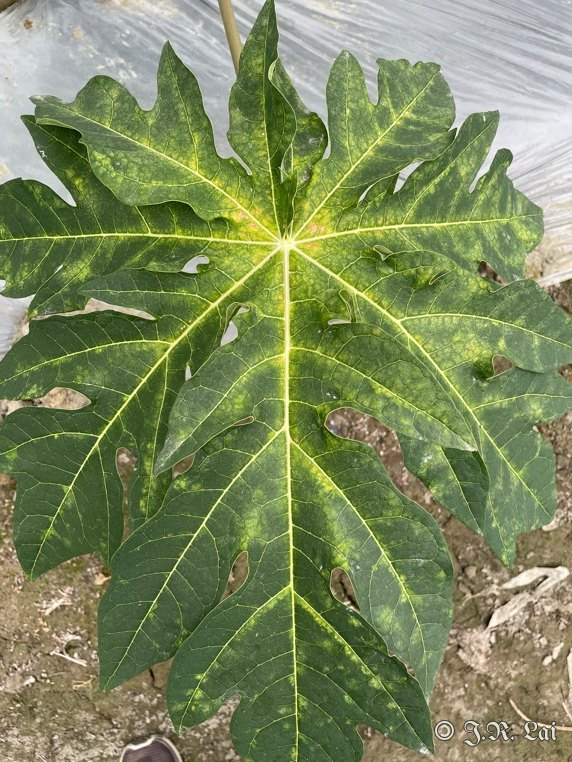
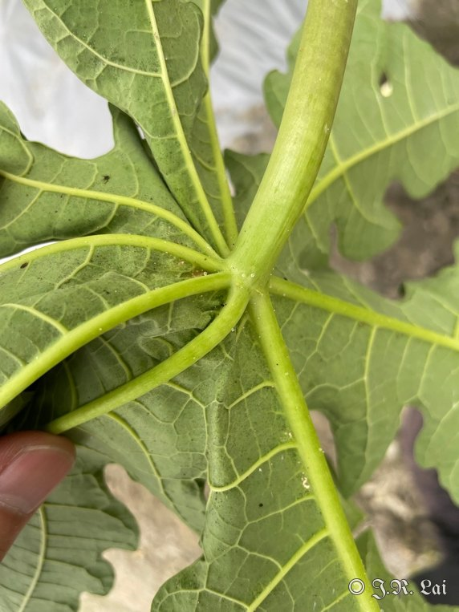
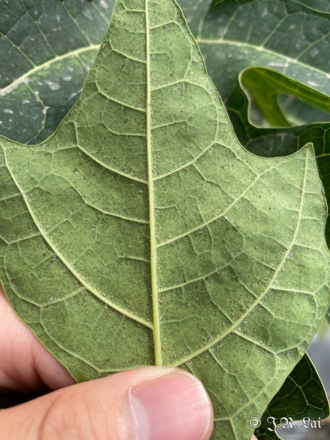
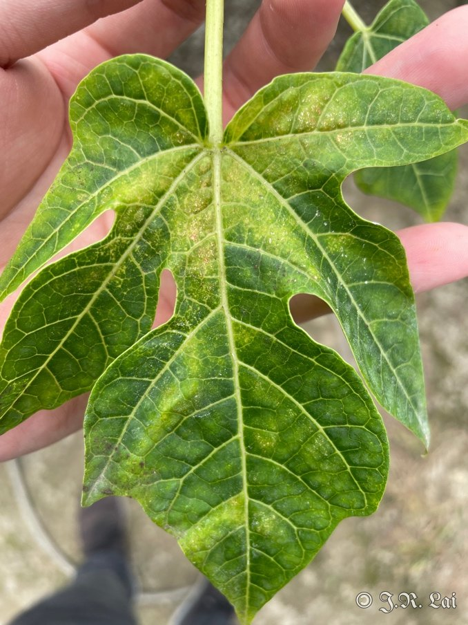
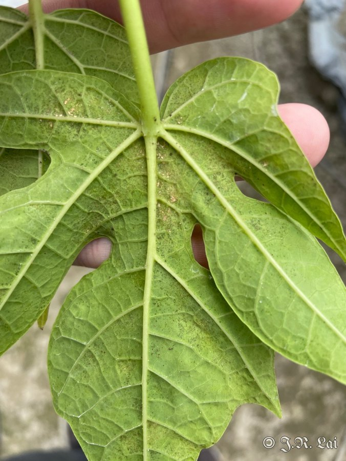
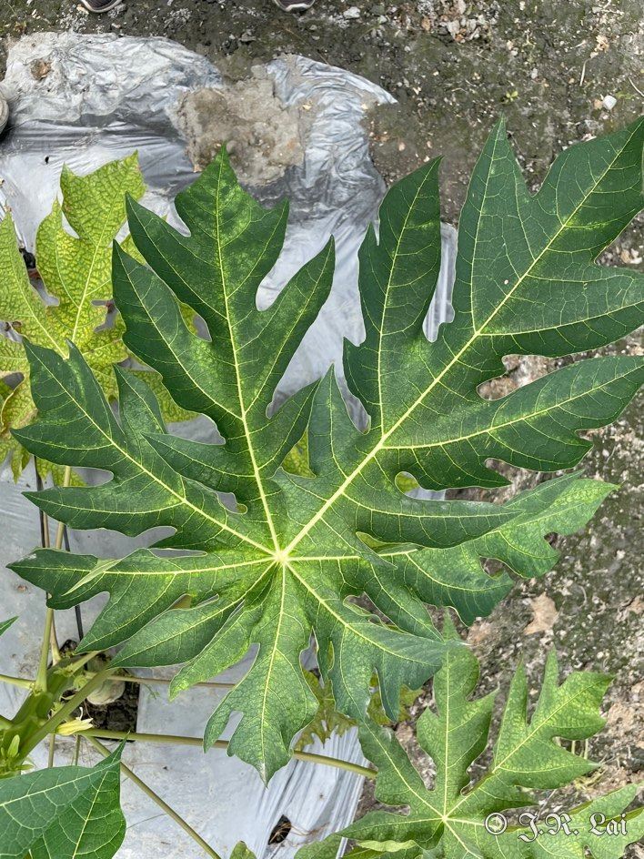
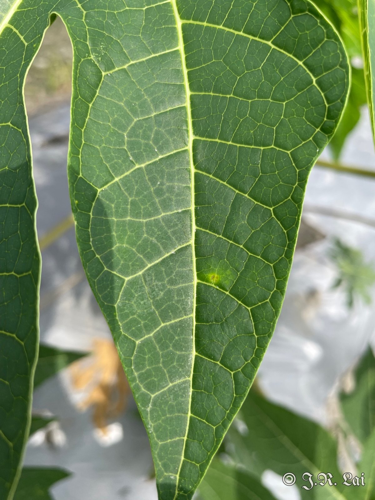
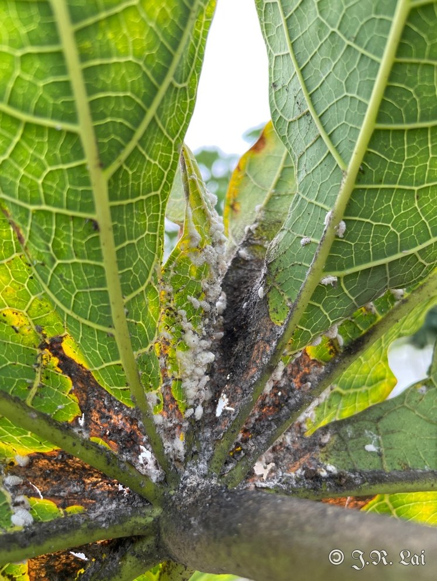
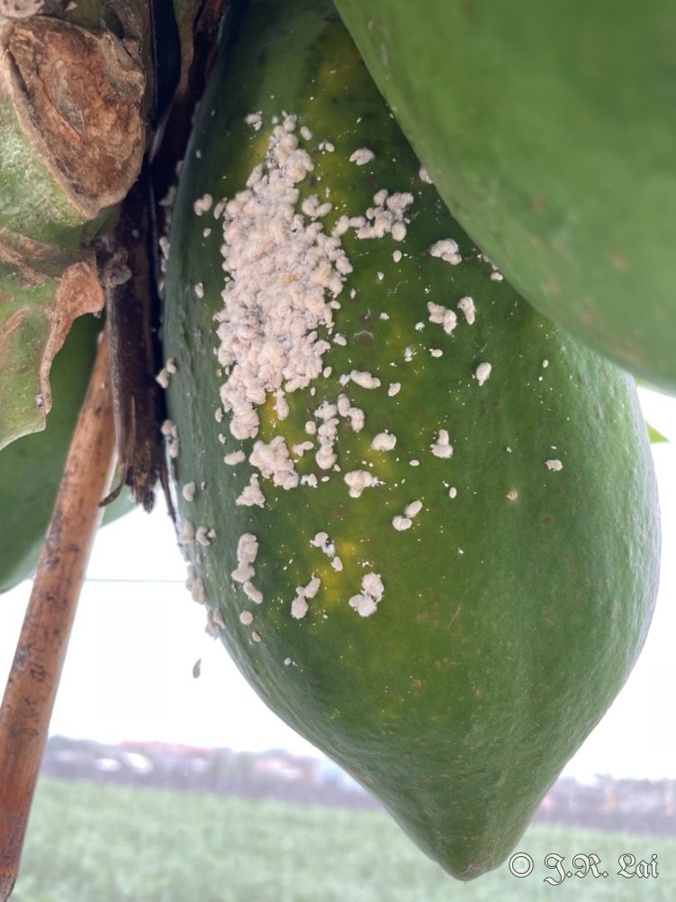

<figure class="photo wide"><figcaption>圖一、葉面褪綠斑駁</figcaption></figure>

本次調查林內五處木瓜園，大多是網室栽培。其中四區都有二點葉蟎，而且有兩區已經全面發生（超過全園一半）。

## 二點葉蟎（第一、三、四區）

<figure class="photo"><figcaption>葉背聚集的葉蟎</figcaption></figure>
<figure class="photo"><figcaption>葉表刺吸危害造成褪綠</figcaption></figure>
<figure class="photo"><figcaption>葉片褪綠，部分黃化</figcaption></figure>
<figure class="photo"><figcaption>葉背褪綠斑點</figcaption></figure>

葉表褪綠，翻到葉背可以看到蟲體集中。第一區為零星發生，第三、四區已經全面發生。

## 二點葉蟎與褐斑病（第二區）

<figure class="photo"><figcaption>葉片表面褪綠，葉背有葉蟎</figcaption></figure>
<figure class="photo"><figcaption>葉片褐色小斑點，外圍有黃暈：褐斑病</figcaption></figure>

全園都有葉蟎危害；另有零星葉片出現外圍帶黃暈的褐色斑點，為木瓜褐斑病。

## 木瓜秀粉介殼蟲（第五區）

<figure class="photo"><figcaption>葉柄基部聚集的介殼蟲與煤煙</figcaption></figure>
<figure class="photo"><figcaption>果實表面的木瓜秀粉介殼蟲</figcaption></figure>

## 診斷結果

第一、三、四區為二點葉蟎危害，第二區為二點葉蟎與木瓜褐斑病，第五區為木瓜秀粉介殼蟲。

## 建議處理

**二點葉蟎**

- 化學防治：依殺蟎（10B）、亞醌蟎（20B）、芬殺蟎（21A）、賜派芬（23）、賜滅芬（23）、賽派芬（25A）
- 生物防治：基徵草蛉、捕植蟎
- 耕作防治：清除園區周圍雜草，降低蟲源
- 有機資材：礦物油。請在傍晚施用，先小面積試噴，三天後沒有藥害再全面施用，且不要連續施用超過三次

**褐斑病**

- 化學防治：平克座（3）、百克敏（11）、福賽快得寧（M1+P7）、賽普護汰寧（9+12）、白列克敏（7+11）
- 褐斑病會經由種苗帶菌，要選用健康種苗
- 摘除罹病嚴重的葉片和葉柄

**木瓜秀粉介殼蟲**

- 購買種苗時先檢查是否帶蟲
- 密度高時，先移除受害的果實和葉片，再進行化學防治
- 同時防治螞蟻，避免螞蟻把介殼蟲搬到其他植株
- 生物防治：蒙氏瓢蟲、草蛉、寄生蜂
- 化學防治：亞滅培（4A）、達特南（4A）、速殺氟（4C）、賜派滅（23）
- 有機資材：礦物油

括號內為作用機制代碼。以上用藥已對照 2025 年 2 月木瓜推薦用藥，最新資訊請參考防檢局農藥資訊服務網。

## 後續追蹤

（待補充）
