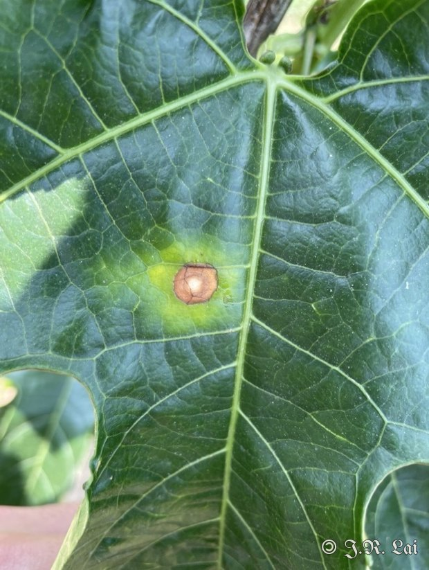
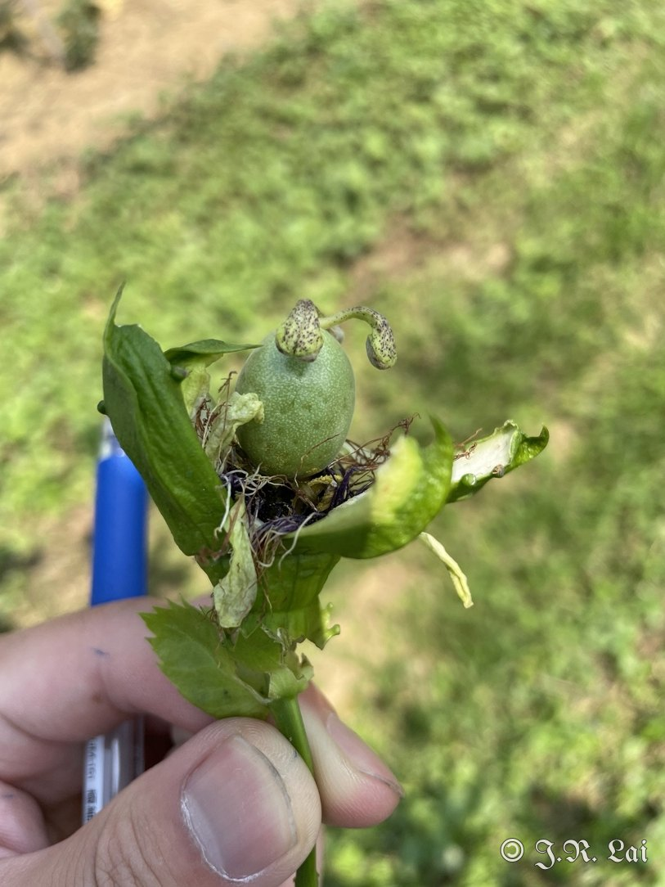

## 現場狀況

<figure class="photo"><figcaption>葉片同心輪紋病斑，周圍有黃暈：炭疽病</figcaption></figure>
<figure class="photo"><figcaption>幼果與新梢受害</figcaption></figure>

露天栽培，全園都有發生。葉片上有明顯的同心輪紋病斑、周圍有黃暈；果實表面有許多凹點。

## 診斷結果

百香果炭疽病與薊馬危害。

## 建議處理

**炭疽病**

- 化學防治：甲基多保淨（1）、得克利（3）、三氟敏（11）、百克敏（11）、亞托敏（11）、扶吉胺（29）、免得爛（M3）、克熱淨（M7）、亞托待克利（3+11）、三氟派瑞（7+11）、賽普護汰寧（9+12）
- 耕作防治：清園，剪除罹病植株殘體
- 有機資材：波爾多液

**薊馬**

- 化學防治：滅賜克（1A）、可尼丁（4A）、亞滅培（4A）、達特南（4A）、賜諾特（5）
- 物理防治：懸掛黃色黏板
- 薊馬在高溫乾燥的季節繁殖很快，提早防治效果較好

括號內為作用機制代碼。以上用藥已對照 2026 年 4 月百香果核准用藥（見[用藥圖表](/charts/)），最新資訊請參考防檢局農藥資訊服務網。

## 後續追蹤

（待補充）
