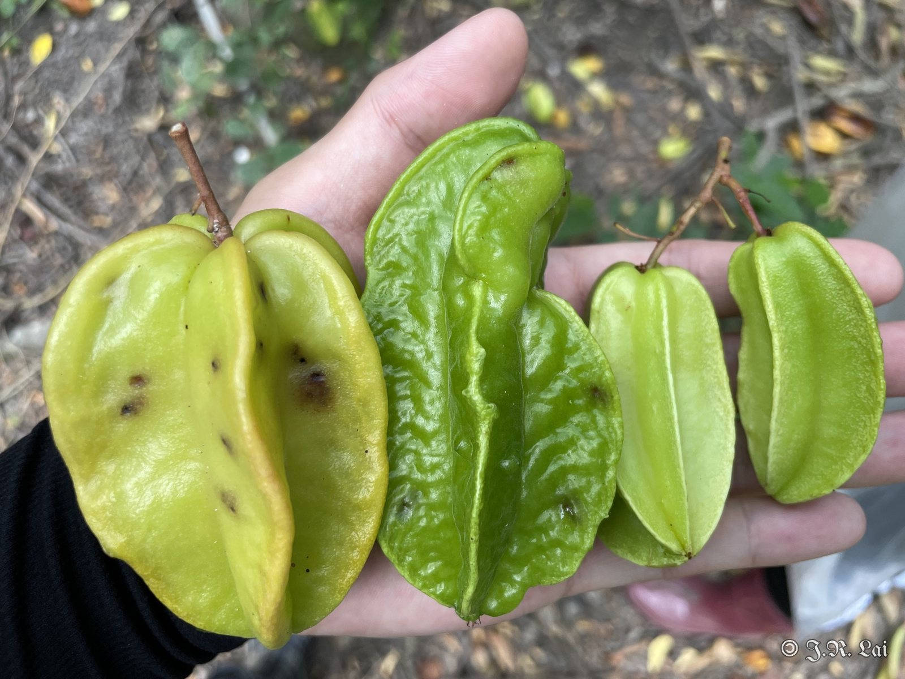
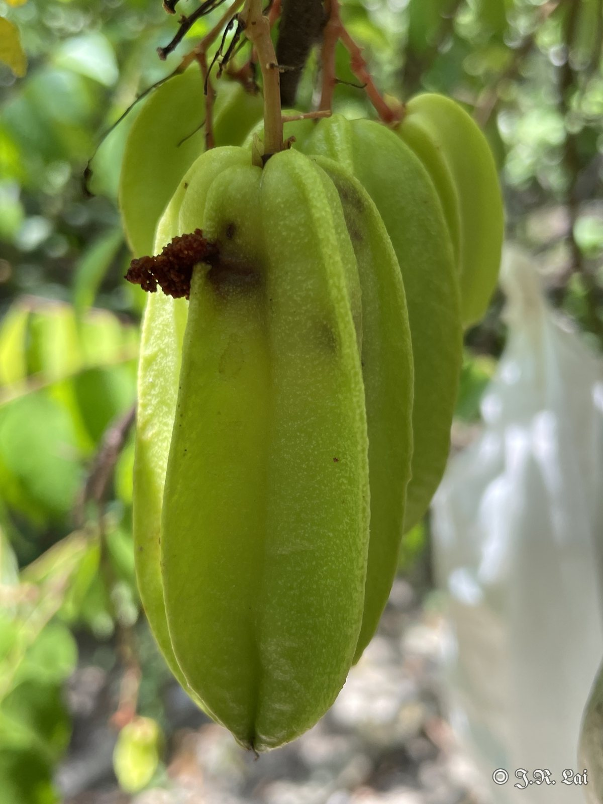
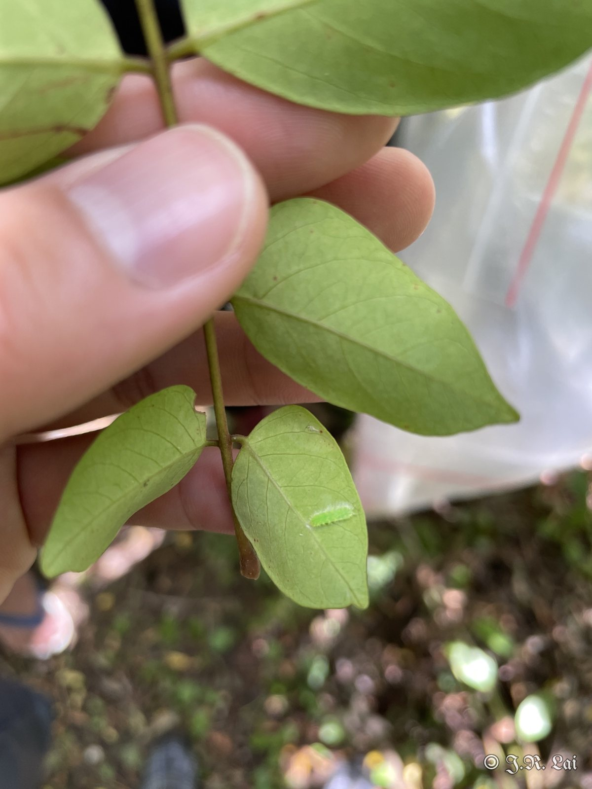
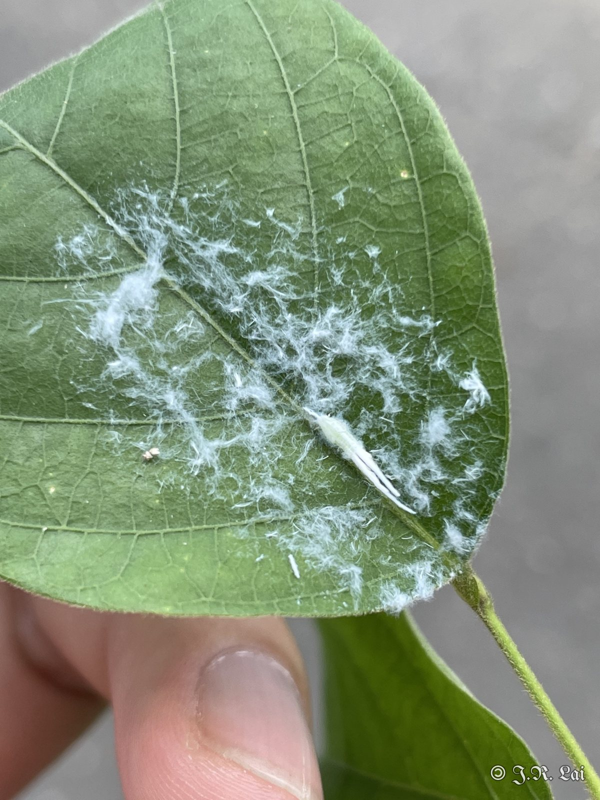
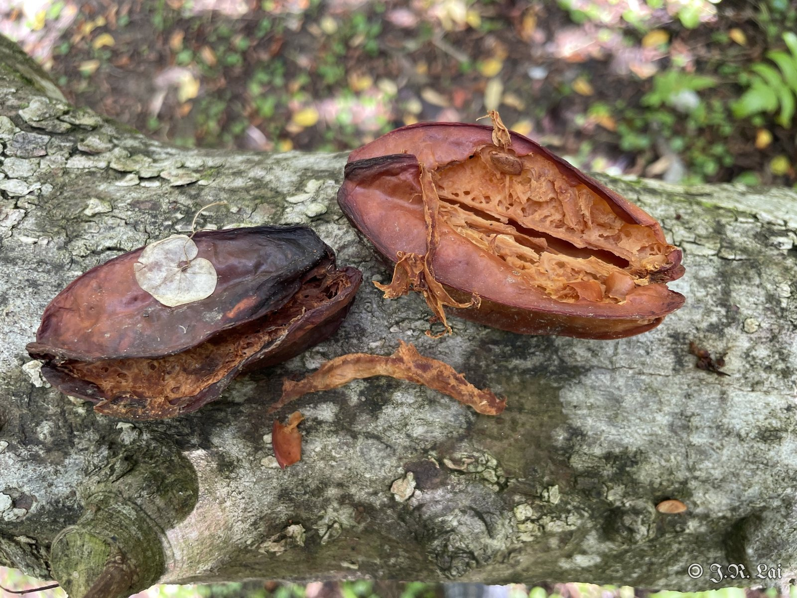
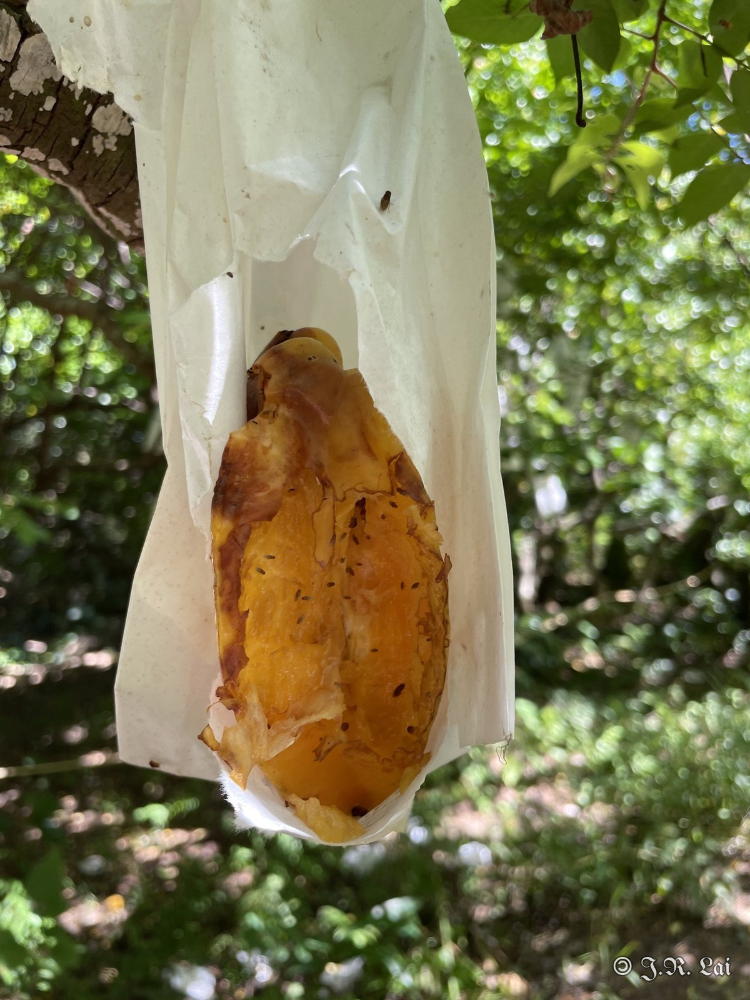
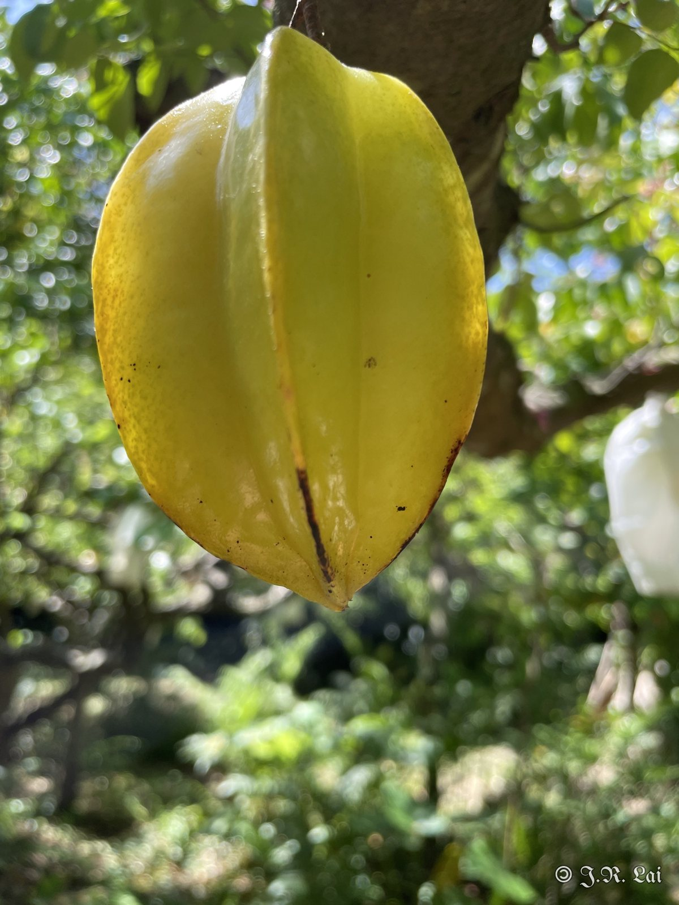

<figure class="photo wide"><figcaption>圖一　左到右：紅龍、馬來西亞、水晶</figcaption></figure>

## 果實蠅

<figure class="photo"><figcaption>果實蠅幼蟲危害狀</figcaption></figure>

## 楊桃鳥羽蛾

<figure class="photo"><figcaption>楊桃鳥羽蛾幼蟲</figcaption></figure>

## 青蛾蠟蟬

<figure class="photo"><figcaption>青蛾蠟蟬若蟲</figcaption></figure>

## 松鼠危害

<figure class="photo"><figcaption>松鼠啃食果實</figcaption></figure>
<figure class="photo"><figcaption>套袋果實遭啃食</figcaption></figure>

## 熱傷害

<figure class="photo"><figcaption>熱傷害（果實接觸袋子處）</figcaption></figure>

## 診斷結果

果實蠅、楊桃鳥羽蛾、青蛾蠟蟬危害，另有松鼠危害及果實熱傷害。

## 建議處理

（待補充）

## 後續追蹤

（待補充）
