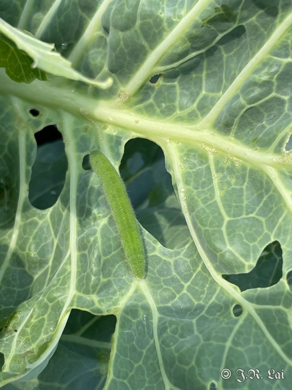

## 現場狀況

<figure class="photo"><figcaption>葉片被幼蟲取食的孔洞與紋白蝶幼蟲</figcaption></figure>

全園都有發生，葉片上有咀嚼式口器害蟲取食的痕跡，並找到紋白蝶幼蟲。

## 診斷結果

紋白蝶（*Pieris rapae*）危害。

## 建議處理

- 使用推薦藥劑，並輪替不同作用機制的藥劑，避免產生抗藥性
- 搭配蘇力菌，以及燈光誘集、黃色黏板加強防治

## 後續追蹤

（待補充）
