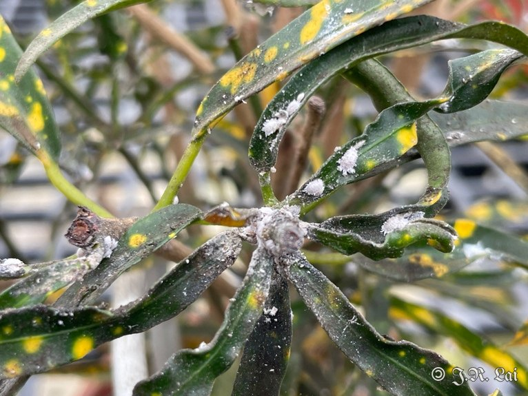
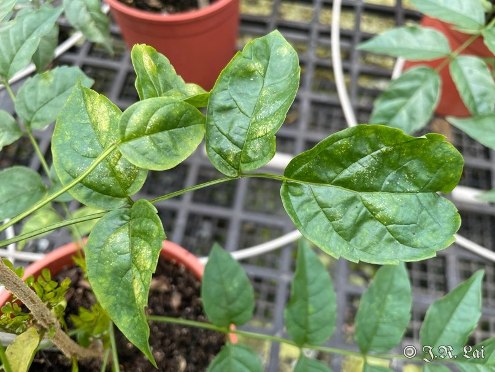
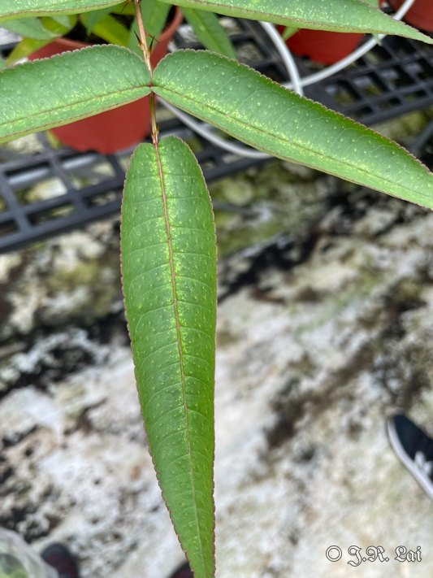
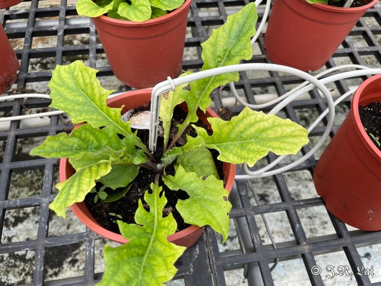
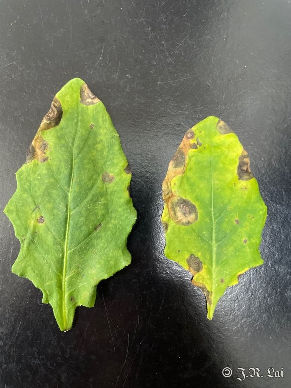
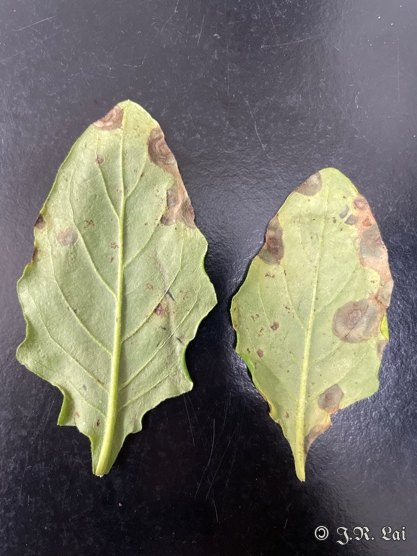
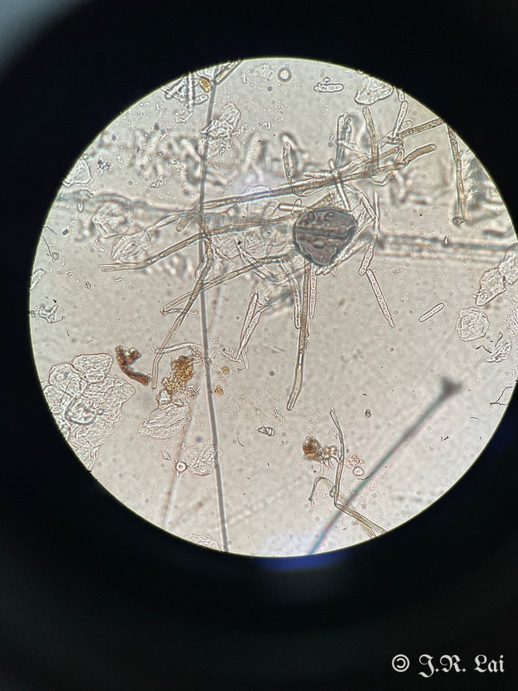
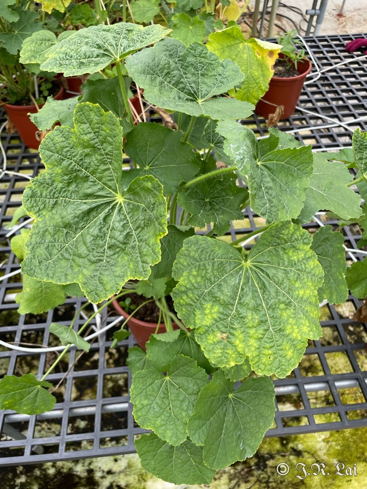

本次到種苗場檢查五種觀賞植物，危害集中在部分區域。

## 變葉木：粉介殼蟲

<figure class="photo"><figcaption>葉片黃化扭曲，覆蓋白色棉絮狀蟲體</figcaption></figure>

## 紫雲藤、刺蔥：葉蟎

<figure class="photo"><figcaption>紫雲藤葉片褪綠、出現斑點</figcaption></figure>
<figure class="photo"><figcaption>刺蔥葉片細小密集的斑點</figcaption></figure>

## 非洲菊：紫斑病與營養障礙

<figure class="photo"><figcaption>葉片褪綠、葉脈顏色較深：營養障礙</figcaption></figure>
<figure class="photo"><figcaption>葉片褐色圓形或橢圓形壞疽：紫斑病</figcaption></figure>
<figure class="photo"><figcaption>病葉背面</figcaption></figure>
<figure class="photo"><figcaption>病斑組織鏡檢</figcaption></figure>

## 蜀葵：病毒病害

<figure class="photo"><figcaption>葉片褪綠，有些微皺縮</figcaption></figure>

## 診斷結果

變葉木為粉介殼蟲，紫雲藤和刺蔥為葉蟎，非洲菊為紫斑病合併營養障礙，蜀葵疑似病毒病害。

## 建議處理

- **變葉木**：先移除受介殼蟲危害的植株，降低蟲口密度，再施用植物油
- **紫雲藤**：灑水可以降低害蟲密度，並搭配植物油
- **刺蔥**：施用植物油
- **非洲菊**：剪除受紫斑病感染的葉片，保持園區通風。營養障礙的部分，建議測量介質的 pH 值和 EC 值，必要時更換介質
- **蜀葵**：可以先施肥觀察能否恢復，但仍建議拔除感染病毒的植株

## 後續追蹤

（待補充）
