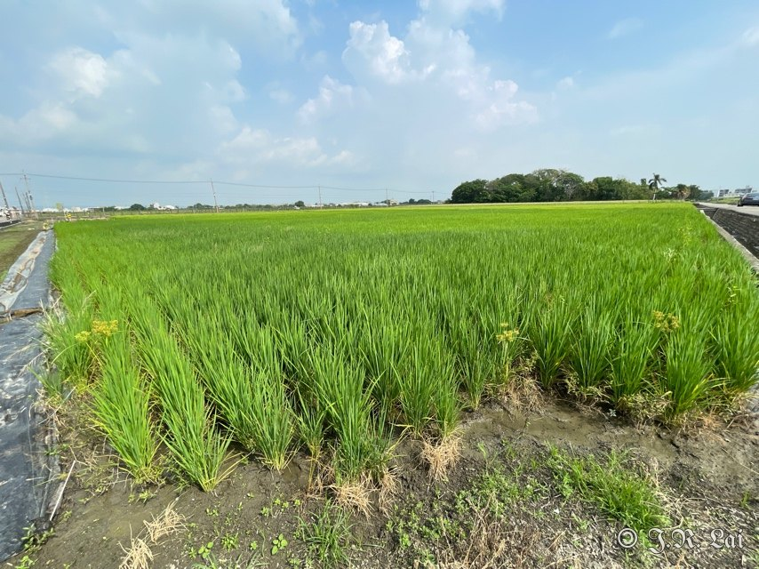
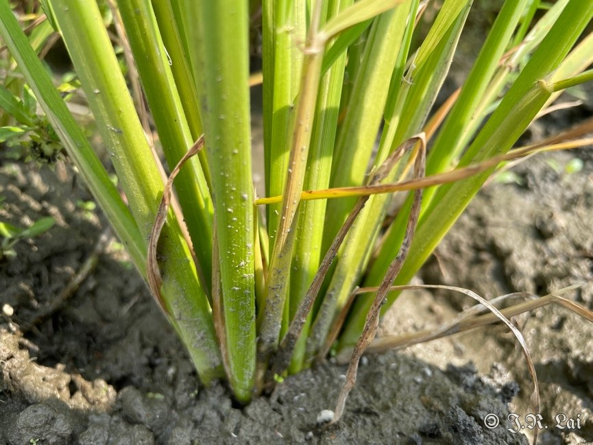
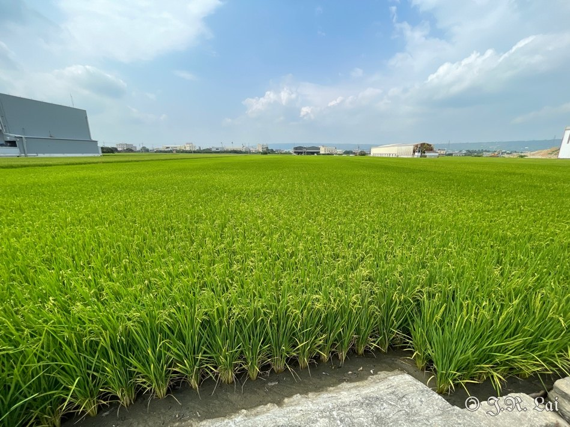
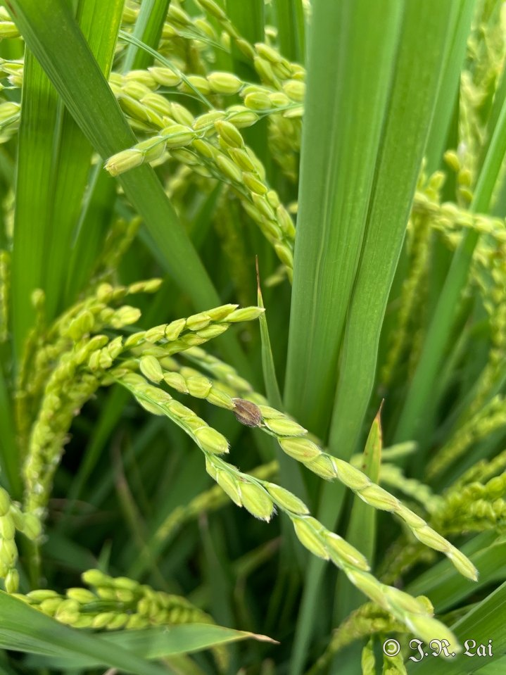
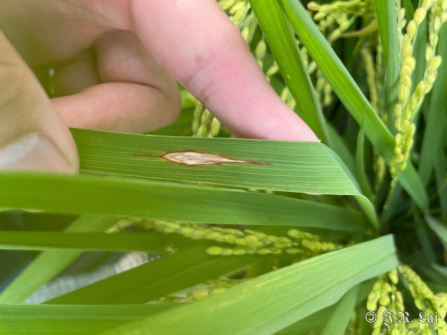
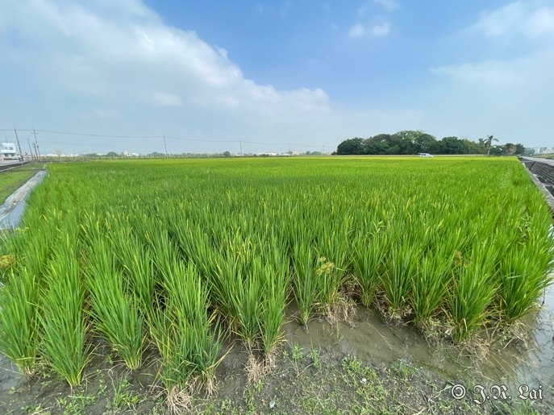
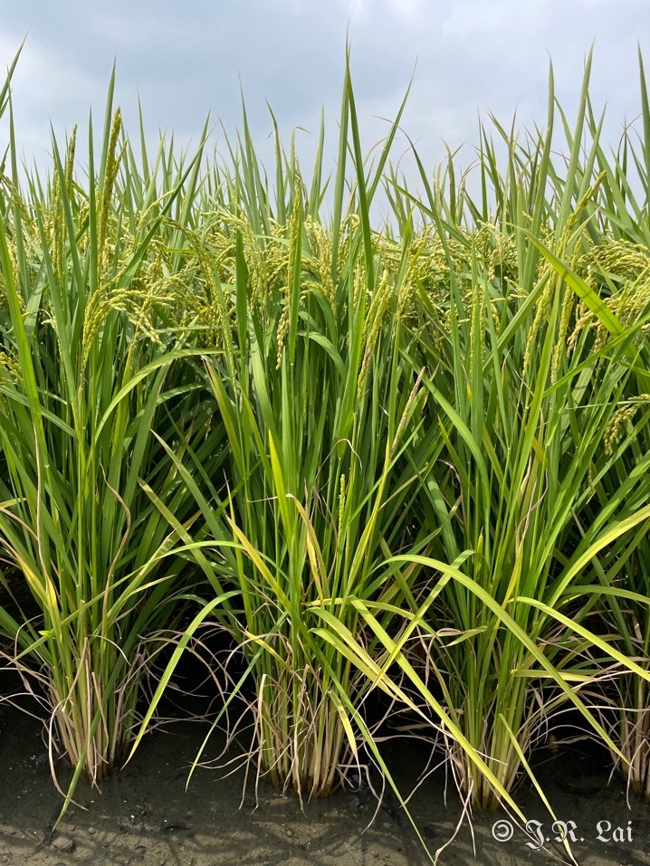
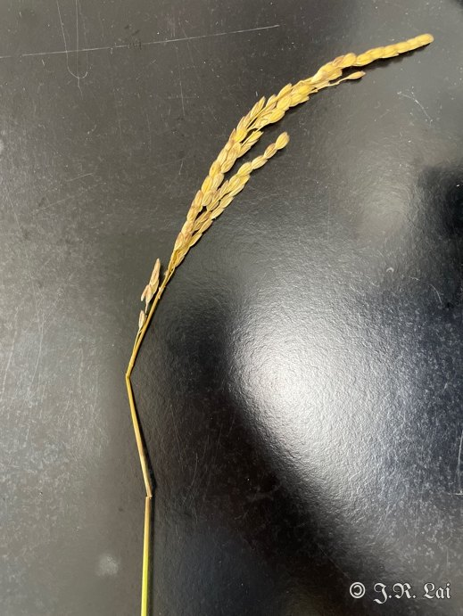
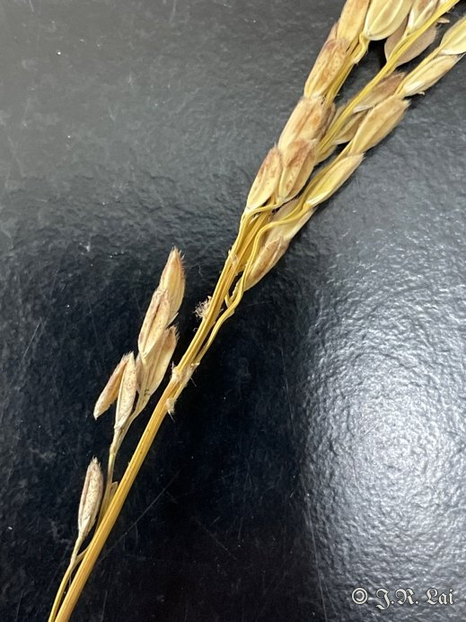
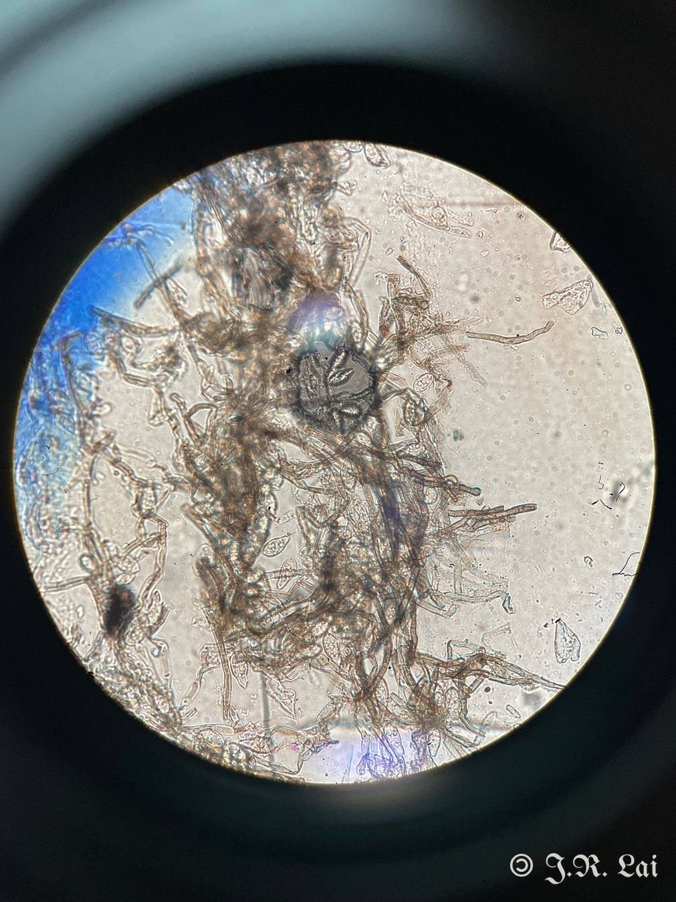

本案追蹤兩塊稻田的稻熱病，5 月 19 日複診，5 月 29 日再追蹤一次。

## A 田（臺農 71 號）

<figure class="photo"><figcaption>A 田田間</figcaption></figure>
<figure class="photo"><figcaption>植株基部</figcaption></figure>

零星葉片出現紡錘狀病斑。

## B 田（臺南 11 號）

<figure class="photo"><figcaption>B 田田間</figcaption></figure>
<figure class="photo"><figcaption>穗部</figcaption></figure>
<figure class="photo"><figcaption>葉片上的紡錘狀病斑</figcaption></figure>

零星葉片出現紡錘狀病斑，部分稻穗有黑化和褐化。

## 診斷結果

兩塊田都是稻熱病，B 田已經有穗部病徵。

## 建議處理

使用稻熱病推薦藥劑進行防治。以上為 2023 年診斷時的推薦藥劑，使用前請到防檢局農藥資訊服務網確認最新登記。

## 後續追蹤

**5 月 29 日**

<figure class="photo"><figcaption>A 田田間</figcaption></figure>
<figure class="photo"><figcaption>B 田植株</figcaption></figure>
<figure class="photo"><figcaption>B 田稻穗褐化</figcaption></figure>
<figure class="photo"><figcaption>B 田稻穗</figcaption></figure>
<figure class="photo"><figcaption>B 田稻穗鏡檢</figcaption></figure>

- **A 田**：葉片只有非常輕微的紡錘狀病斑，暫時還不需要防治，持續觀察。
- **B 田**：病徵和上次差不多，零星葉片有紡錘狀病斑，部分稻穗黑化、褐化，採樣回實驗室鏡檢。
