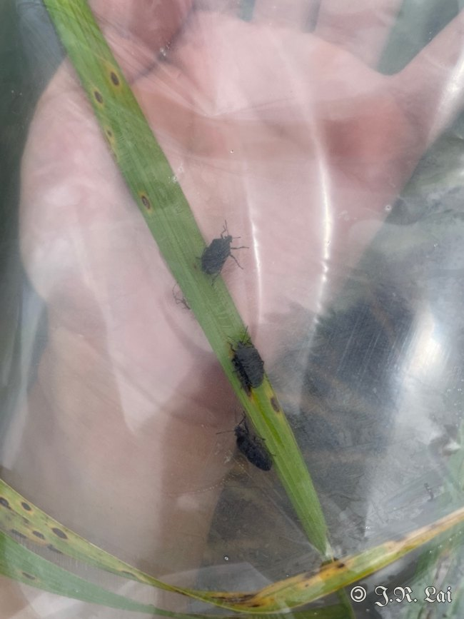
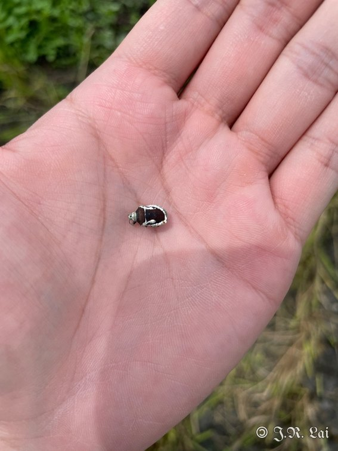
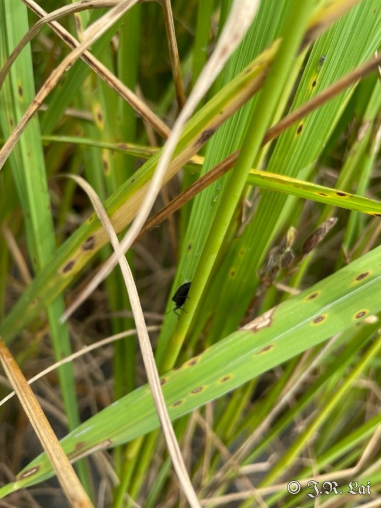
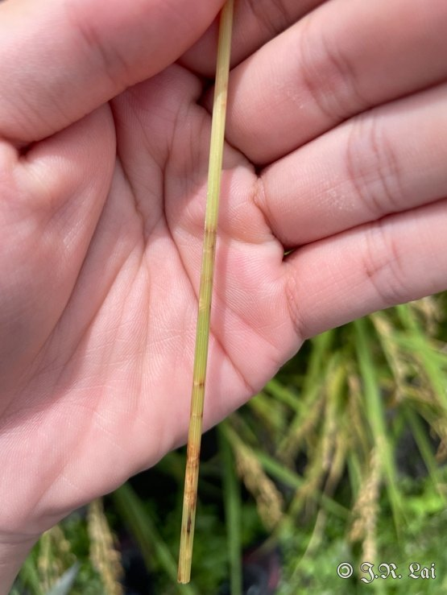
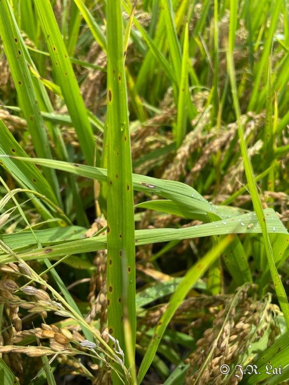
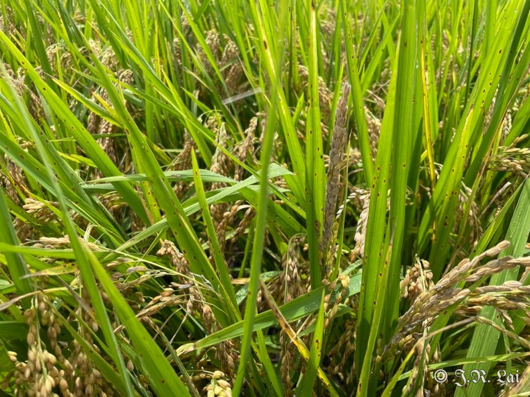
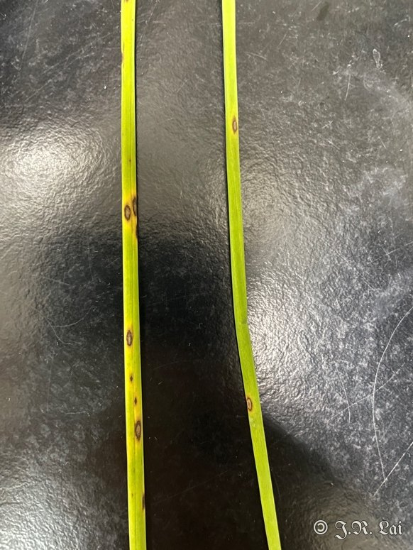
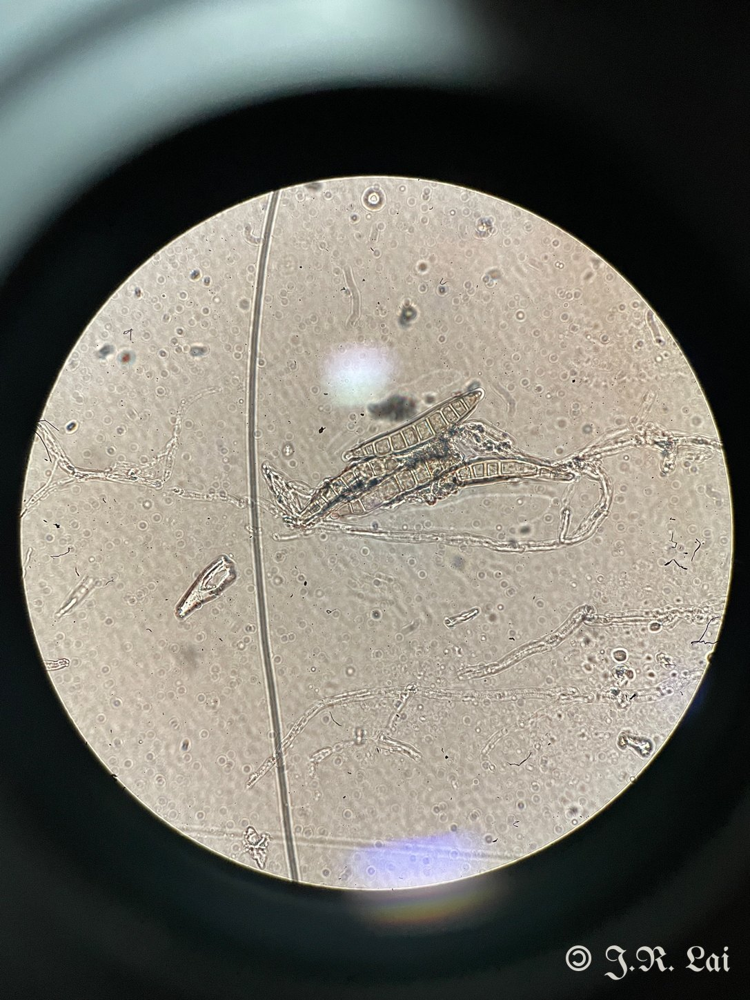

<figure class="photo wide"><figcaption>圖一、關山的稻田</figcaption></figure>

全園都有發生。

## 水稻黑椿象

<figure class="photo"><figcaption>稻莖上的黑椿象</figcaption></figure>
<figure class="photo"><figcaption>水稻黑椿象成蟲</figcaption></figure>

稻株上有褐色的刺吸狀小斑點，並找到水稻黑椿象。

## 胡麻葉枯病

<figure class="photo"><figcaption>葉片上的灰褐色斑點</figcaption></figure>
<figure class="photo"><figcaption>葉片病斑</figcaption></figure>
<figure class="photo"><figcaption>田間葉片病斑</figcaption></figure>
<figure class="photo"><figcaption>田間葉片病斑</figcaption></figure>
<figure class="photo"><figcaption>葉片上如胡麻狀的斑點</figcaption></figure>
<figure class="photo"><figcaption>鏡檢可見病原菌分生孢子</figcaption></figure>

葉片上出現像胡麻粒一樣的灰褐色斑點，周圍有黃暈。

## 診斷結果

水稻黑椿象與水稻胡麻葉枯病。

## 建議處理

- **水稻黑椿象**：推薦藥劑有丁基加保扶、加保利、免扶克、免敵克、治滅蝨、速殺氟、繁米松等，也可以用黑殭菌進行生物防治
- **胡麻葉枯病**：推薦藥劑有普克利、鋅錳乃浦、錳乃浦等

以上為 2023 年診斷時的推薦藥劑，使用前請到防檢局農藥資訊服務網確認最新登記。

## 後續追蹤

（待補充）
