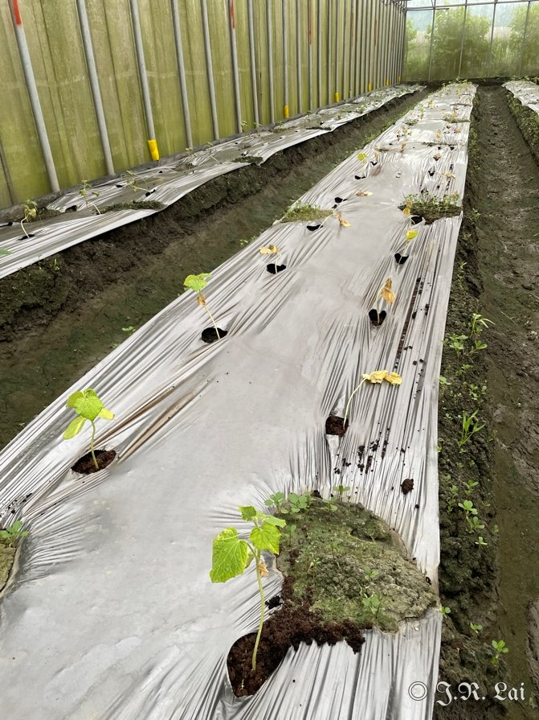
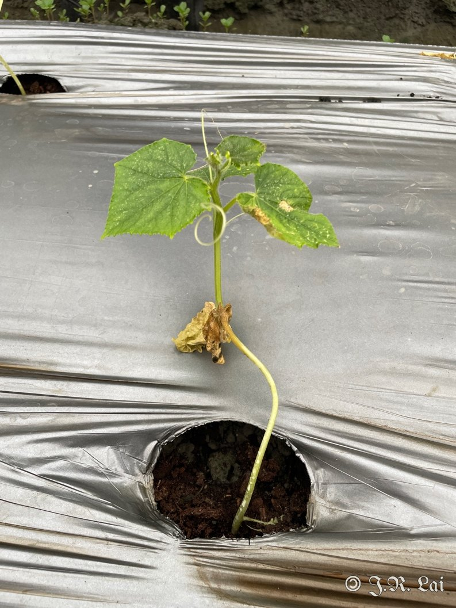
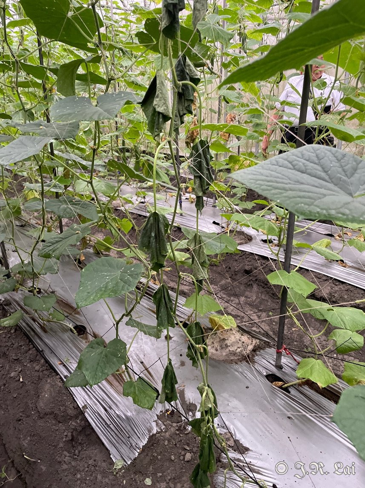
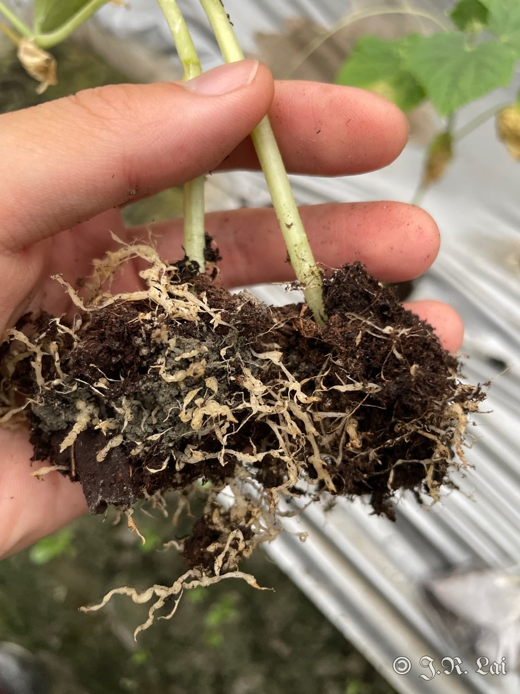
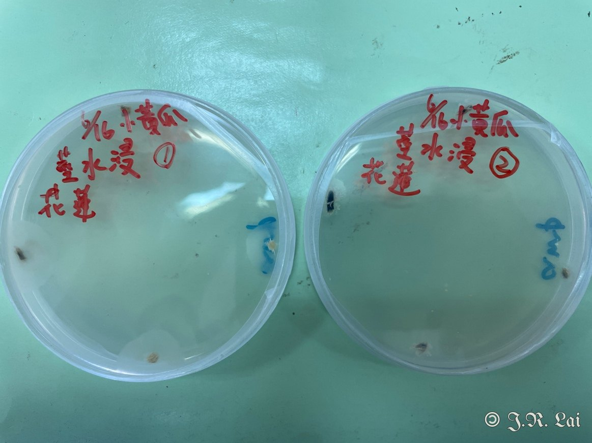

## 現場狀況

<figure class="photo"><figcaption>畦面上小苗萎凋、缺株</figcaption></figure>
<figure class="photo"><figcaption>小苗萎凋</figcaption></figure>
<figure class="photo"><figcaption>較大的植株也有萎凋</figcaption></figure>

全園都有發生。植株在小苗時期就萎凋，部分葉片有水浸狀病徵。

## 診斷依據

<figure class="photo"><figcaption>根部長滿根瘤</figcaption></figure>
<figure class="photo"><figcaption>莖部分離培養，沒有長出萎凋病菌或疫病菌</figcaption></figure>

一開始從病徵推斷，可能是萎凋病（*Fusarium* sp.）或疫病。但是帶回實驗室分離培養後，兩種病原菌都沒有分離到；再檢查根部，發現長滿根瘤，判斷是根瘤線蟲。這塊田長期連作，也可能有連作障礙。

## 診斷結果

根瘤線蟲危害，並可能合併連作障礙。

## 建議處理

先解決根瘤線蟲，再處理連作障礙，觀察是否改善。

- **根瘤線蟲**：推薦藥劑有歐殺滅、氟派瑞、氟速芬，也可以使用幾丁質等免登記植物保護資材
- **連作障礙**：可以直接換土、高溫消毒，或改良土壤、添加有益微生物肥料。做這些處理之前，建議先把土壤送到試驗改良場所檢測

以上為 2023 年診斷時的推薦藥劑，使用前請到防檢局農藥資訊服務網確認最新登記。

## 後續追蹤

（待補充）
