<figure class="photo wide">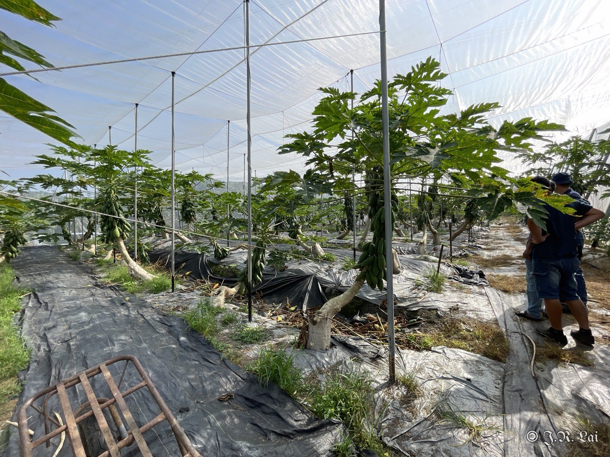<figcaption>圖一、網室木瓜園</figcaption></figure>

本案調查兩處網室木瓜園：第一區位於竹山（約三分半地），第二區位於鹿谷（約兩分半地）。

## 第一區（竹山）

### 園區環境

<figure class="photo">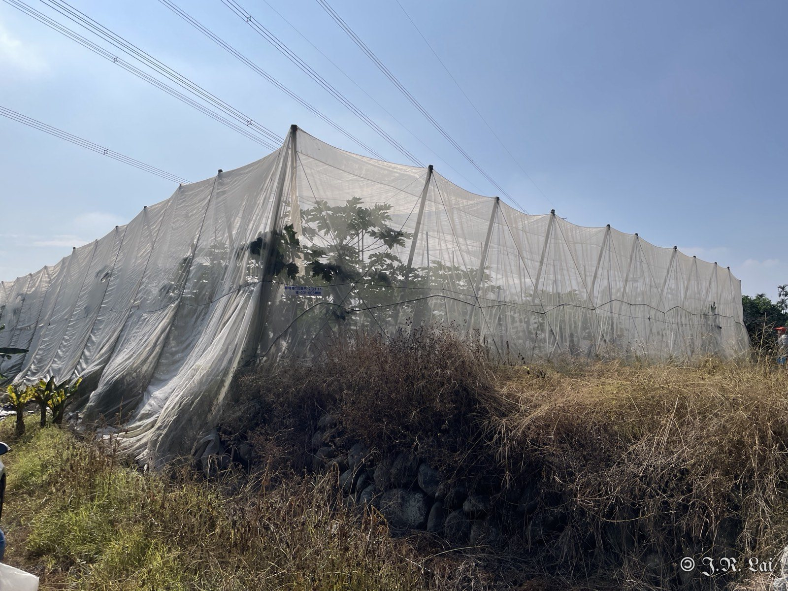<figcaption>網室外觀</figcaption></figure>
<figure class="photo">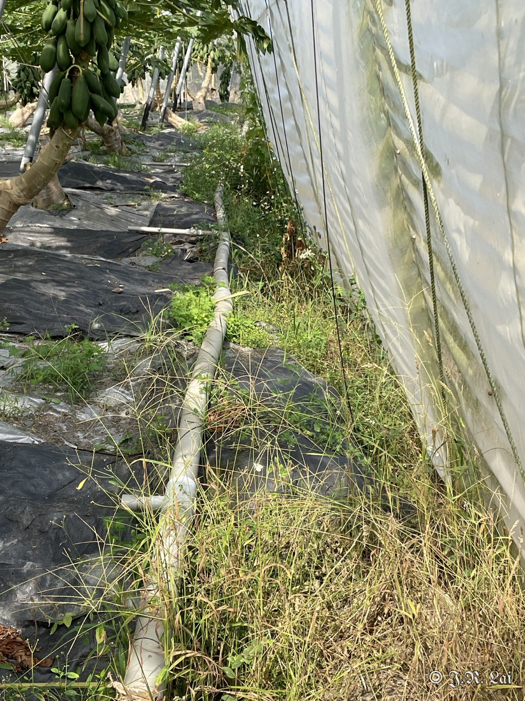<figcaption>園區周圍有大花咸豐草</figcaption></figure>
<figure class="photo">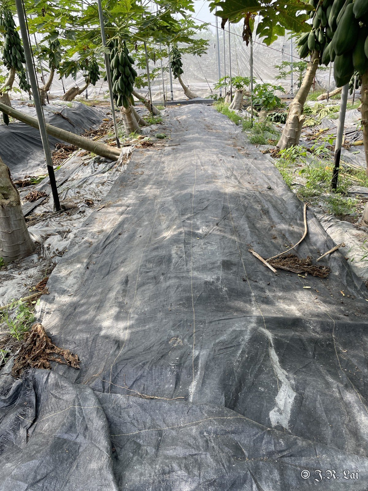<figcaption>園區有鋪抑草蓆，旁邊種植竹子</figcaption></figure>
<figure class="photo">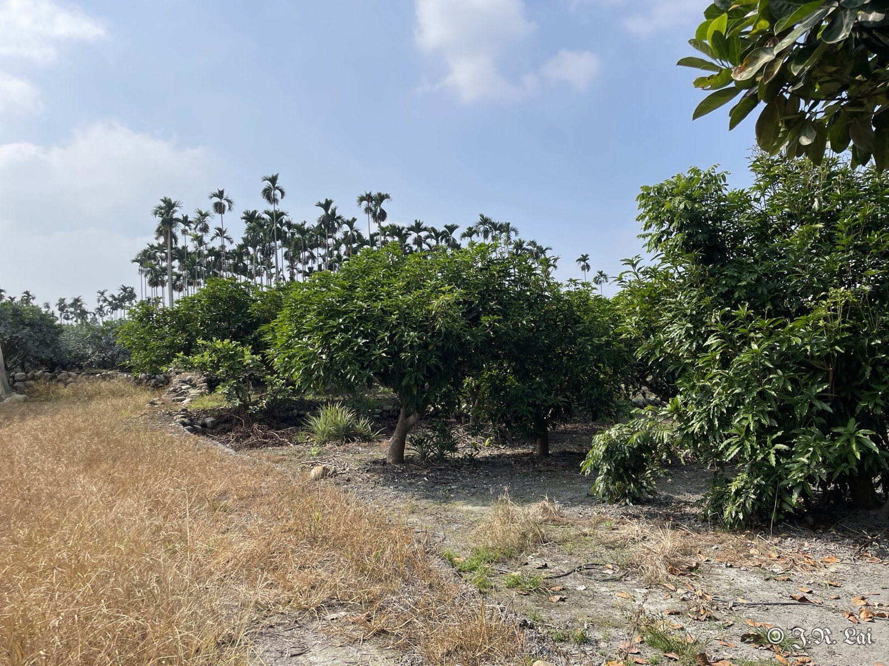<figcaption>鄰近種植柑橘、芭樂</figcaption></figure>

### 木瓜秀粉介殼蟲

<figure class="photo">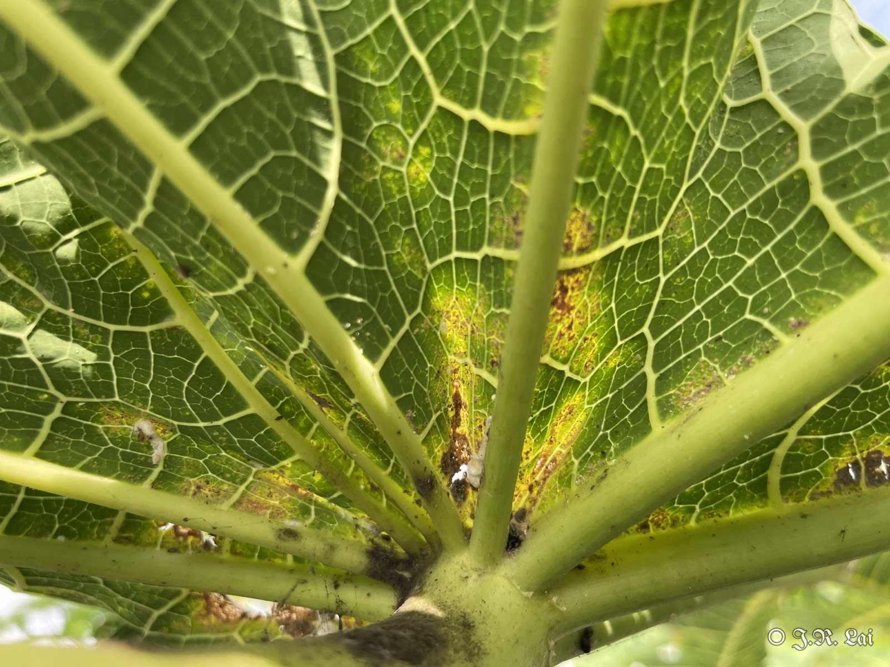<figcaption>葉背受害黃化</figcaption></figure>
<figure class="photo">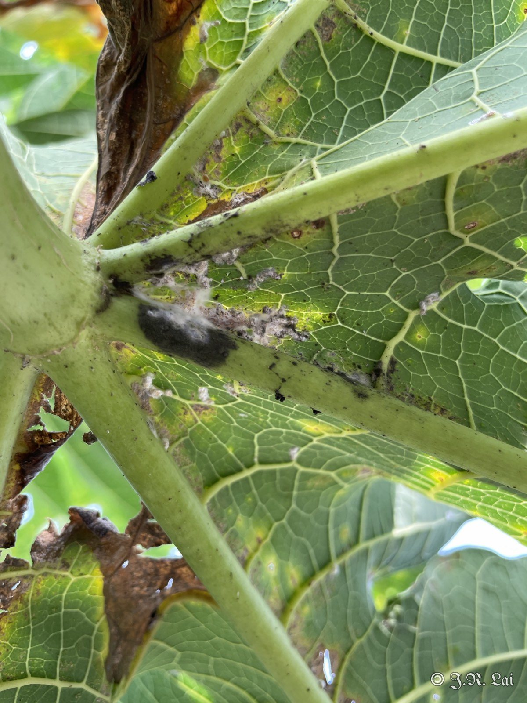<figcaption>葉柄基部聚集介殼蟲</figcaption></figure>
<figure class="photo">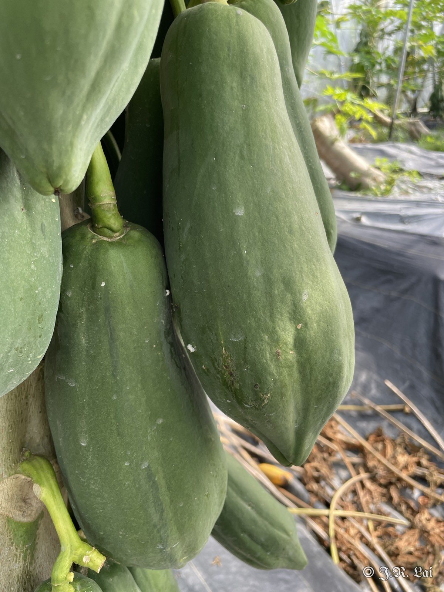<figcaption>果實表面的介殼蟲</figcaption></figure>
<figure class="photo">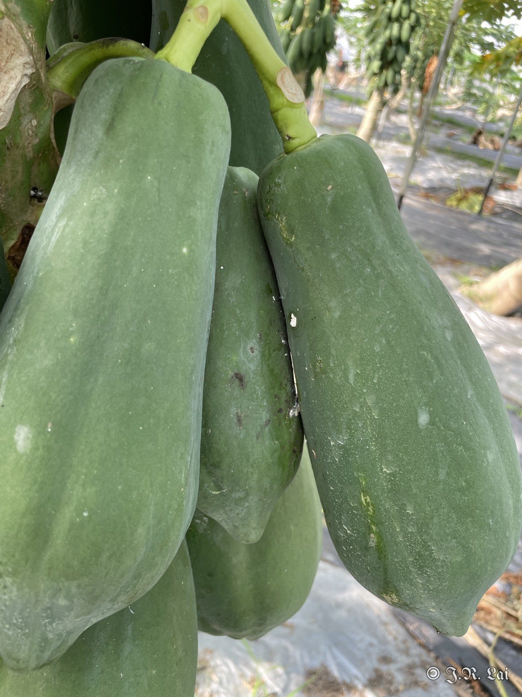<figcaption>果實表面的介殼蟲</figcaption></figure>

幾乎每棵木瓜都有木瓜秀粉介殼蟲（調查 10 棵，10 棵都有），雖然發生率高，但目前危害程度不嚴重。

## 第二區（鹿谷）

<figure class="photo">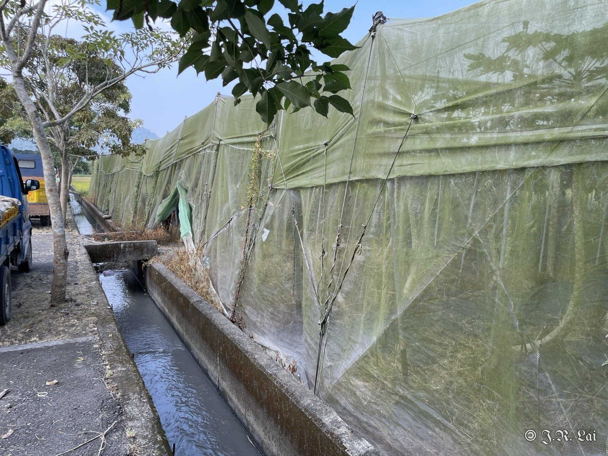<figcaption>網室外觀</figcaption></figure>
<figure class="photo">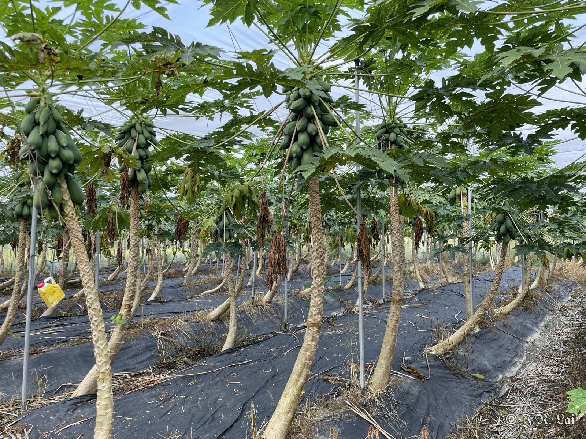<figcaption>網室內木瓜</figcaption></figure>
<figure class="photo">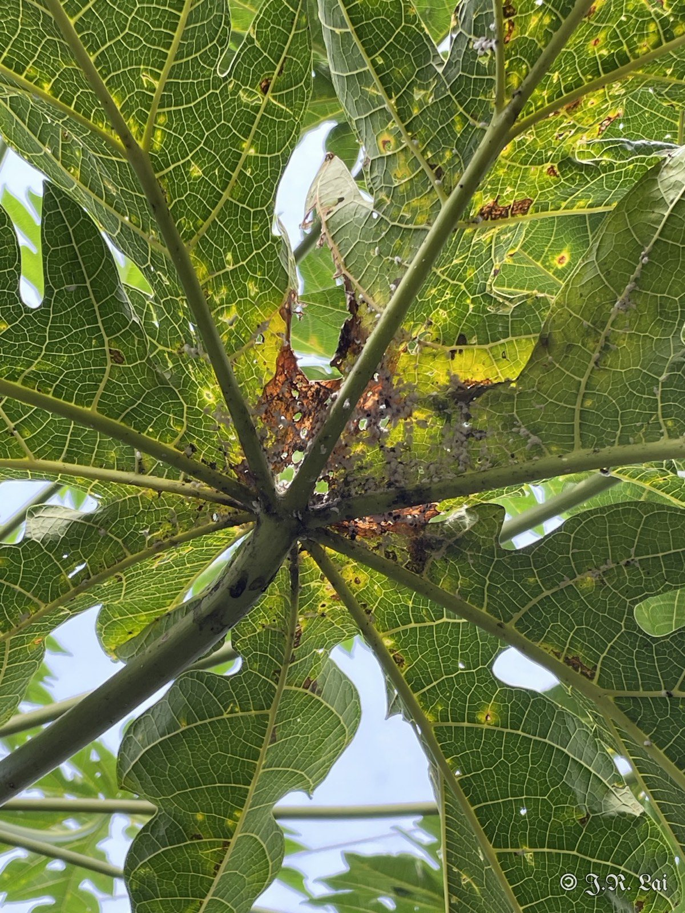<figcaption>葉片黃化，葉柄基部有介殼蟲</figcaption></figure>
<figure class="photo">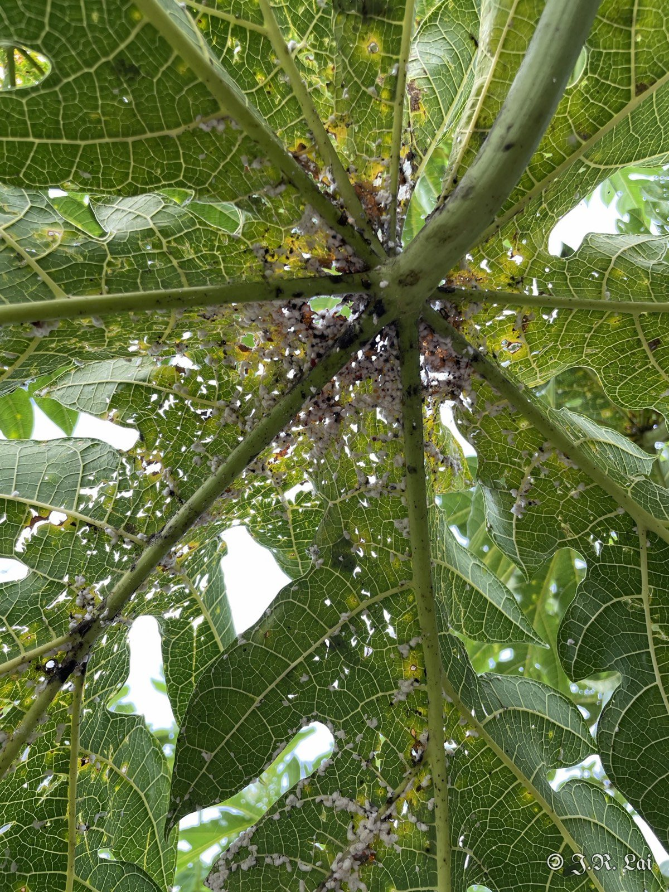<figcaption>葉背介殼蟲群聚</figcaption></figure>
<figure class="photo">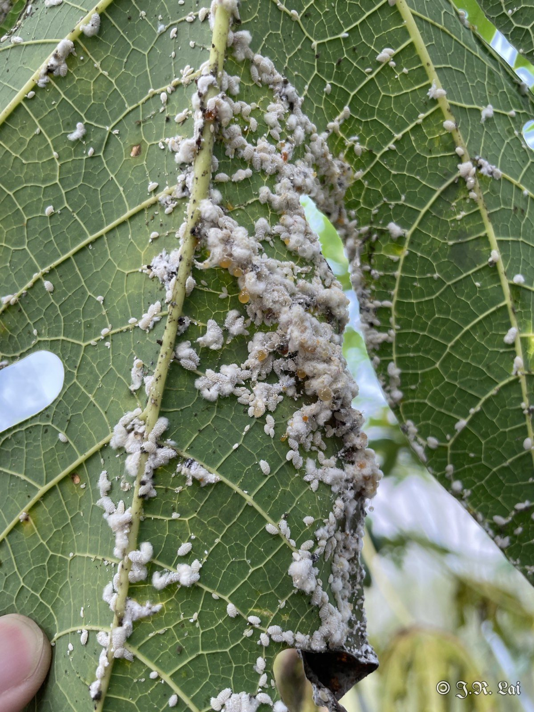<figcaption>木瓜秀粉介殼蟲近照</figcaption></figure>

## 診斷結果

木瓜秀粉介殼蟲危害。

## 建議處理

（待補充）

## 後續追蹤

（待補充）
