<figure class="photo wide">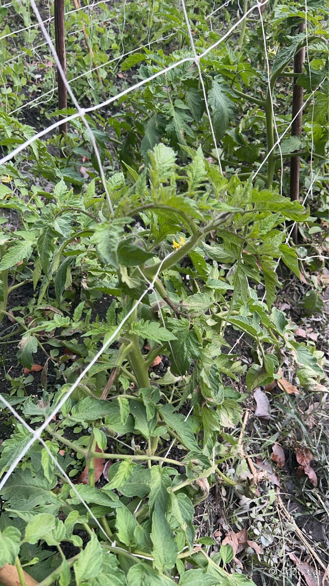<figcaption>圖一　田區現場</figcaption></figure>

## 田間病徵

<figure class="photo">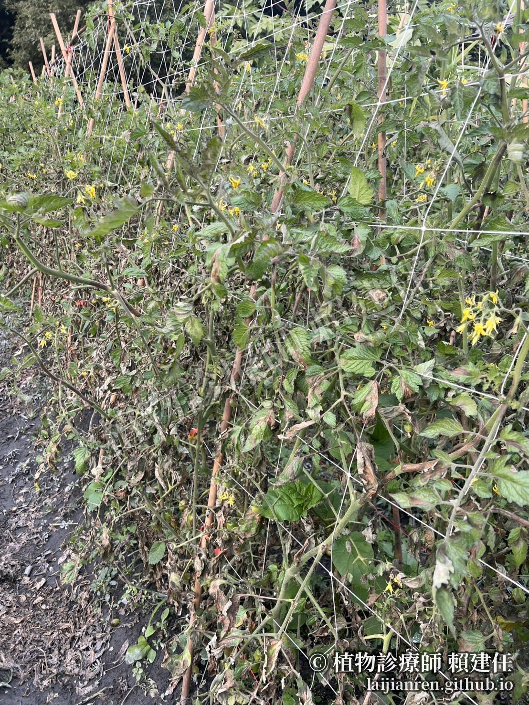<figcaption>植株大面積枯萎</figcaption></figure>
<figure class="photo">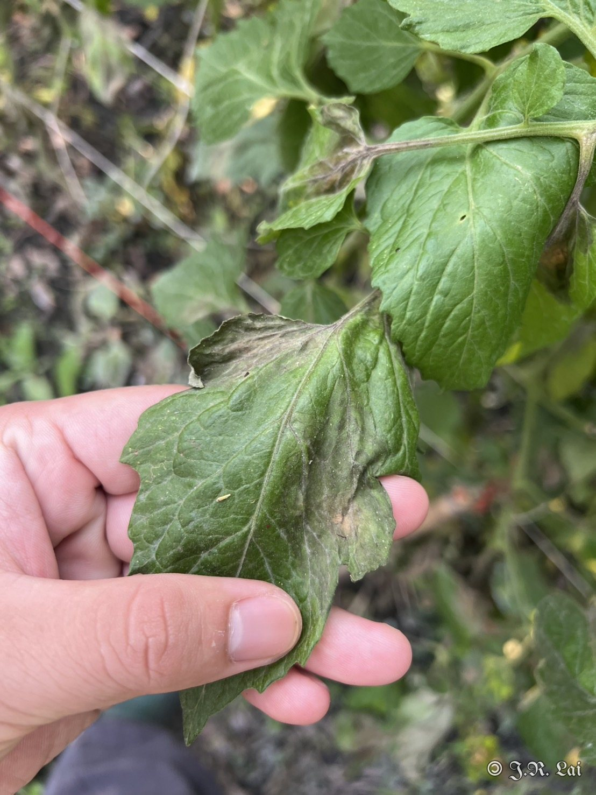<figcaption>葉面水浸狀病徵</figcaption></figure>
<figure class="photo">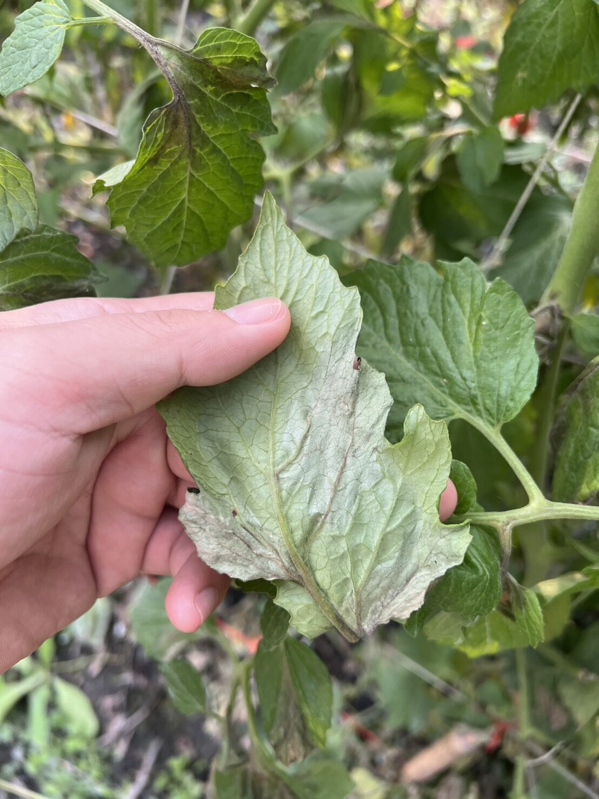<figcaption>葉背出現灰白色黴狀物</figcaption></figure>
<figure class="photo">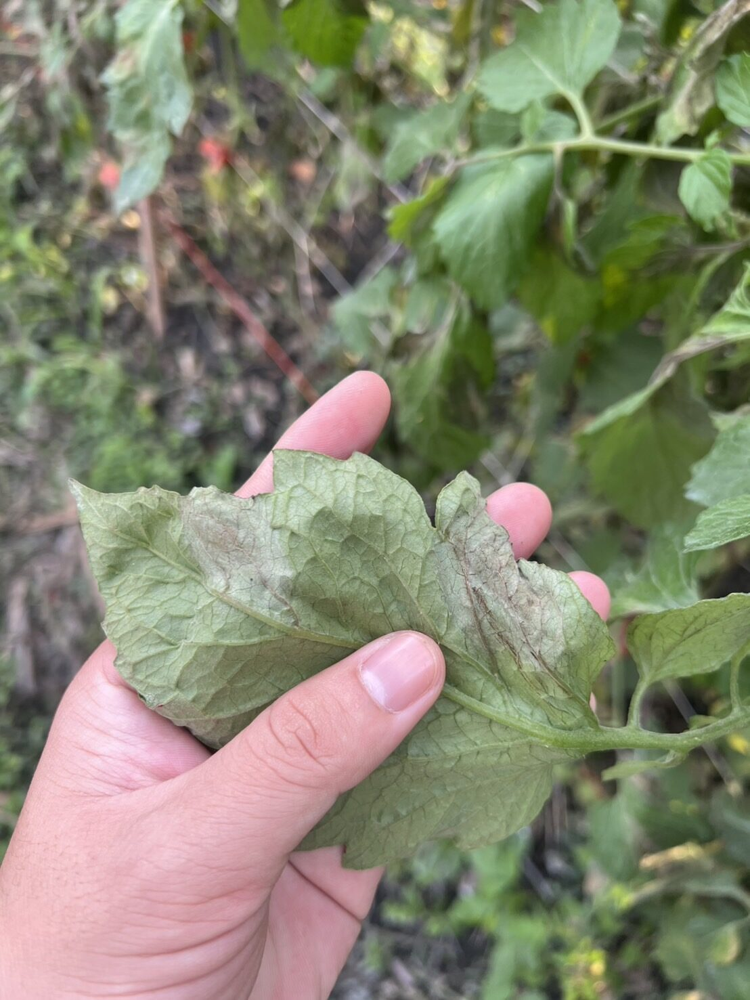<figcaption>葉背可同時出現水浸狀病斑</figcaption></figure>
<figure class="photo">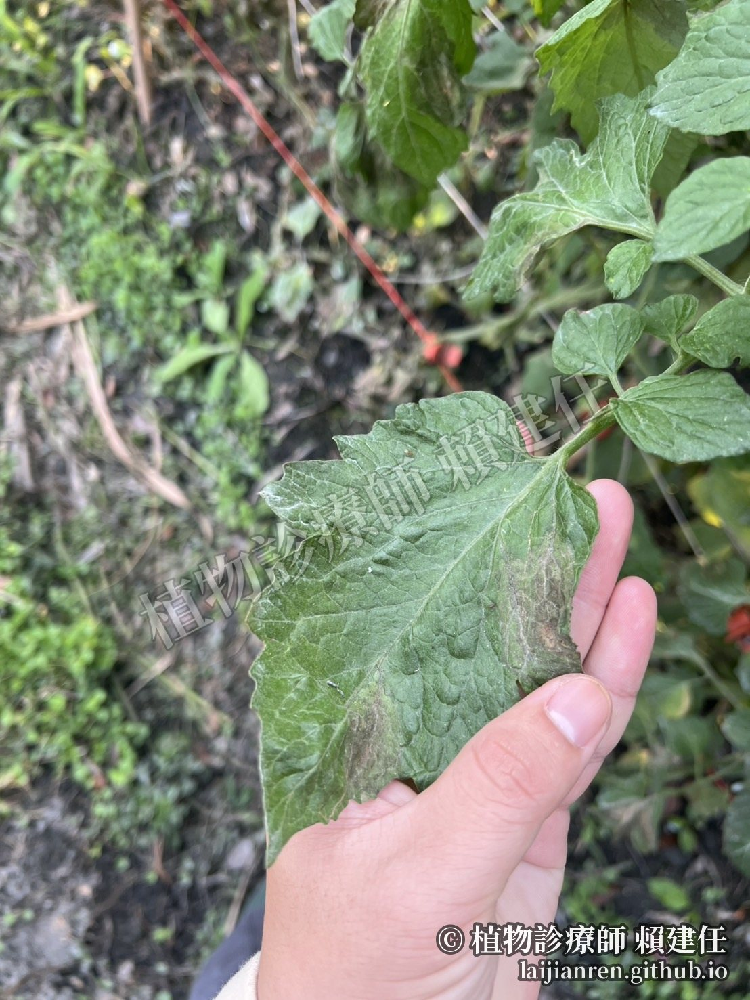<figcaption>不規則病斑</figcaption></figure>
<figure class="photo">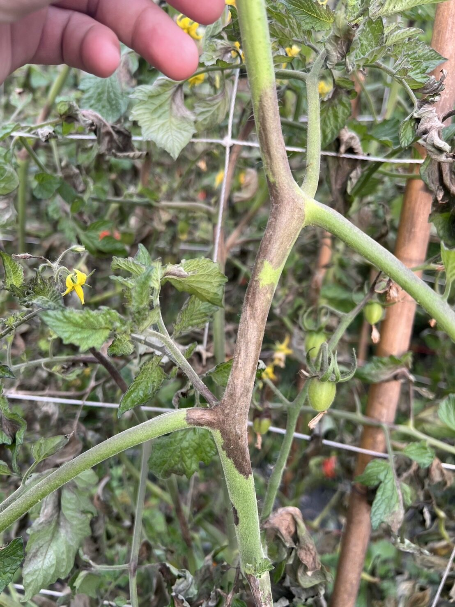<figcaption>莖部出現褐色水浸狀病徵，俗稱「黑骨」</figcaption></figure>
<figure class="photo">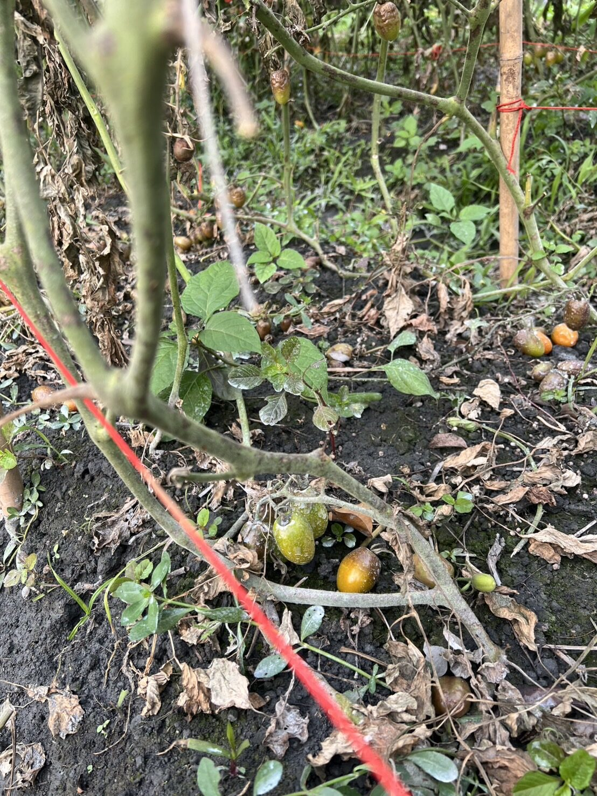<figcaption>小蕃茄大量落果</figcaption></figure>
<figure class="photo">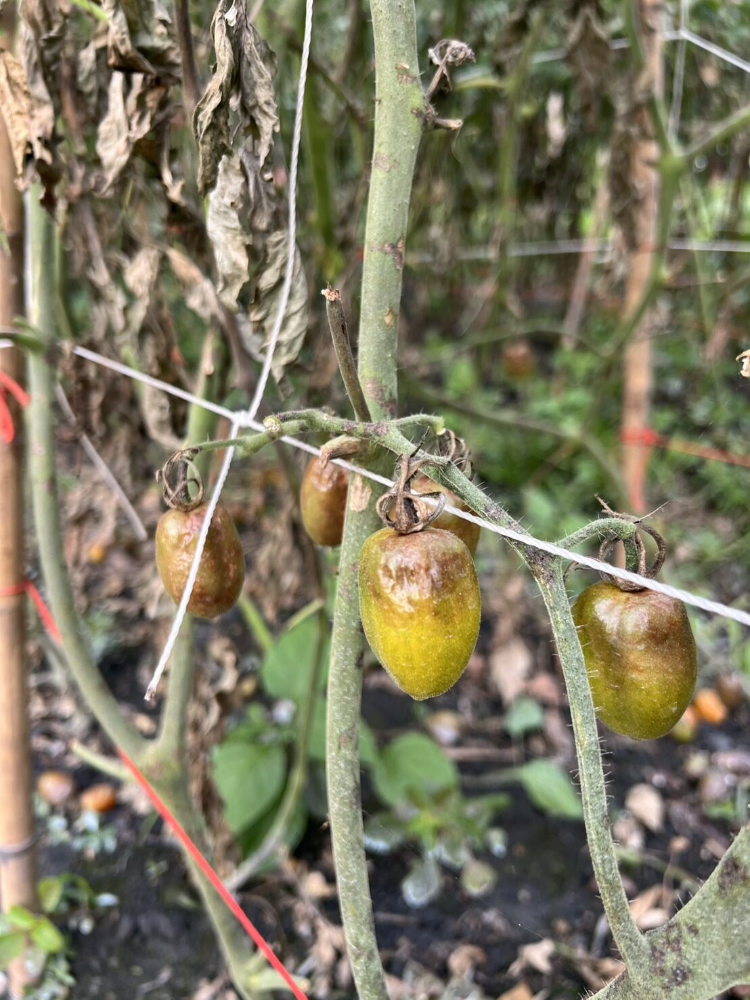<figcaption>果實水浸狀</figcaption></figure>

## 病原鑑定

<figure class="photo">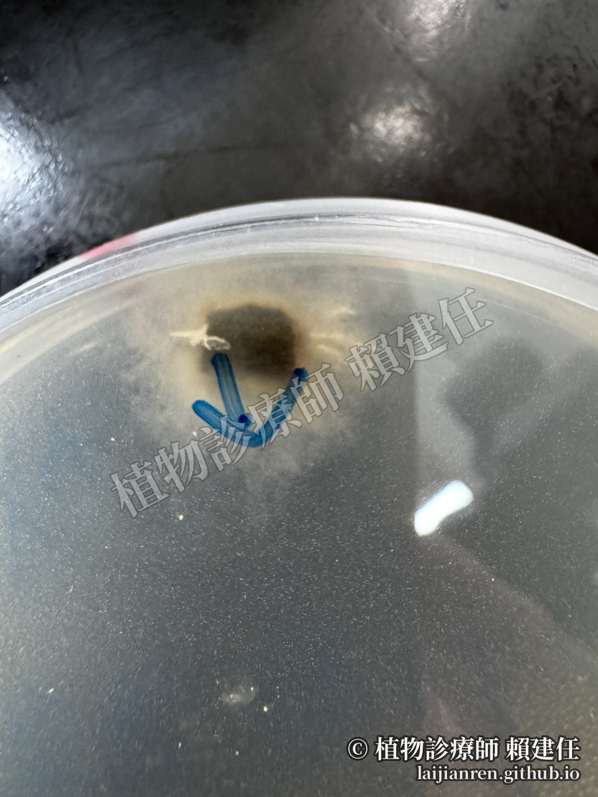<figcaption>裸麥培養基上的菌落</figcaption></figure>
<figure class="photo">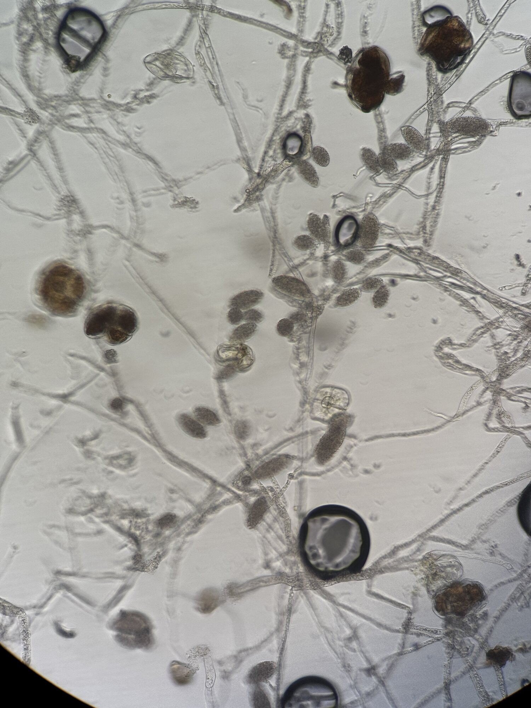<figcaption>孢囊與菌絲（顯微鏡）</figcaption></figure>
<figure class="photo">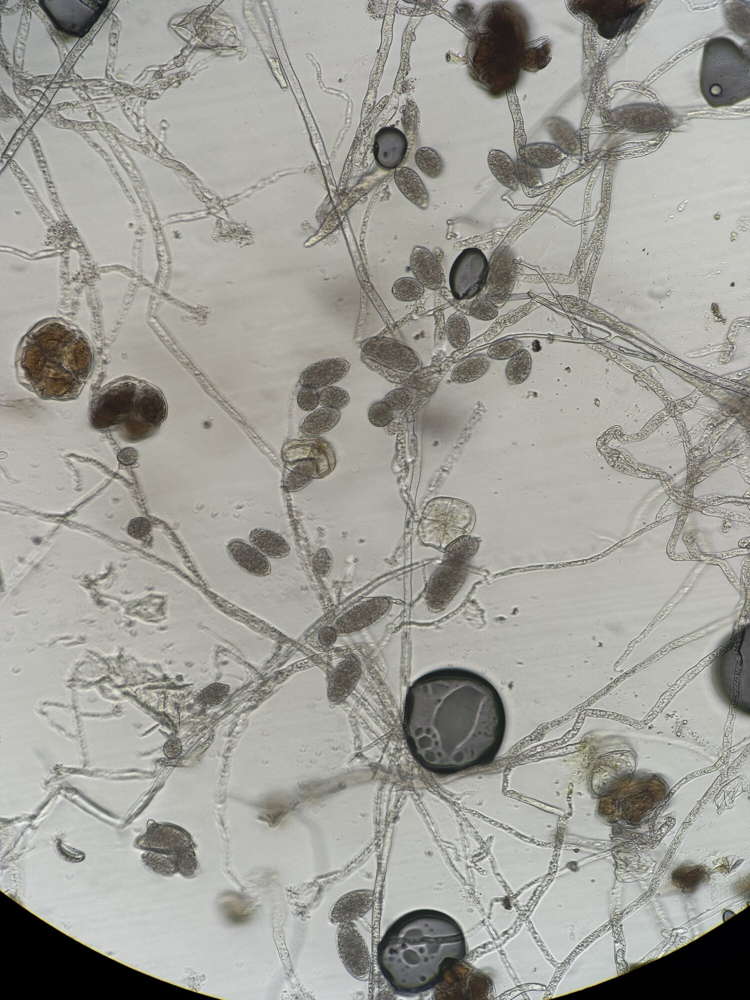<figcaption>孢囊（顯微鏡）</figcaption></figure>

分離出的菌株長在裸麥培養基上，菌絲看起來比較厚。顯微鏡下可見大量檸檬形至橢圓形的孢囊，著生在菌絲上，符合晚疫病菌 *Phytophthora infestans* 的特徵。

## 診斷結果

晚疫病（*Phytophthora infestans*）。

## 建議處理

因為危害嚴重，建議：

1. 將剩餘小番茄採收後，全株砍除。
2. 用波爾多液進行土壤消毒，避免病原菌擴散。
3. 下一期作改種其他非茄科、非馬鈴薯等晚疫病菌寄主的作物，例如十字花科蔬菜。

## 後續追蹤

（待補充）
