<figure class="photo wide">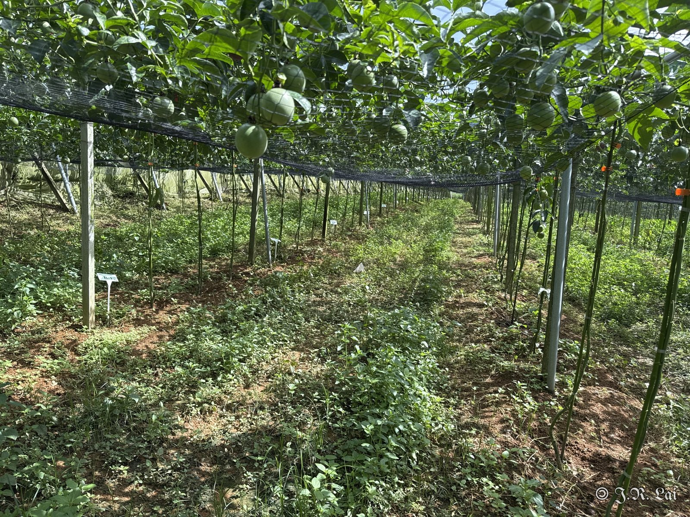<figcaption>圖一、百香果園</figcaption></figure>

## 果實蠅

<figure class="photo">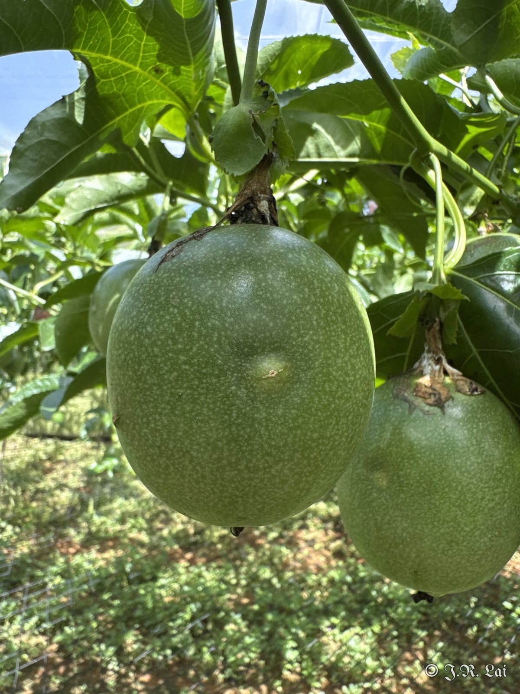<figcaption>果實蠅雌蟲以產卵管刺入果實，造成果實組織不正常增生而突起</figcaption></figure>
<figure class="photo">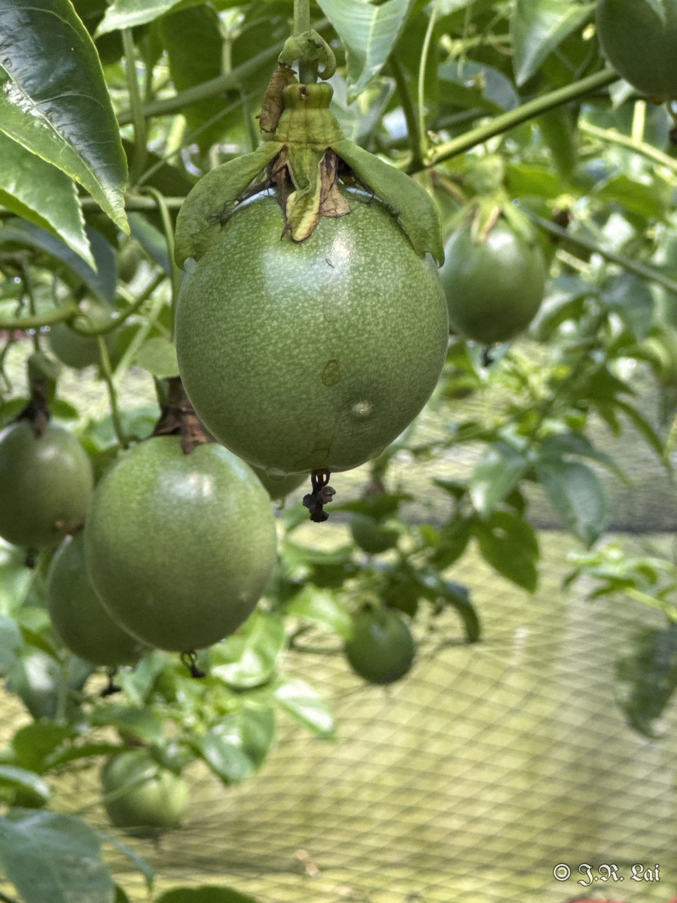<figcaption>果實蠅危害果實</figcaption></figure>

## 高溫障礙

<figure class="photo">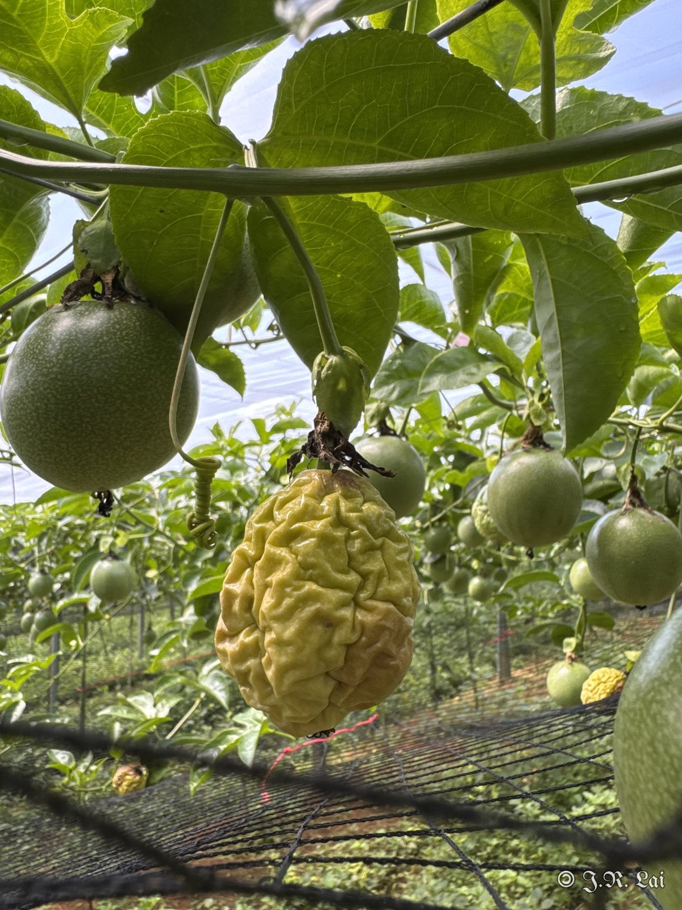<figcaption>高溫障礙：果實黃化皺縮</figcaption></figure>
<figure class="photo">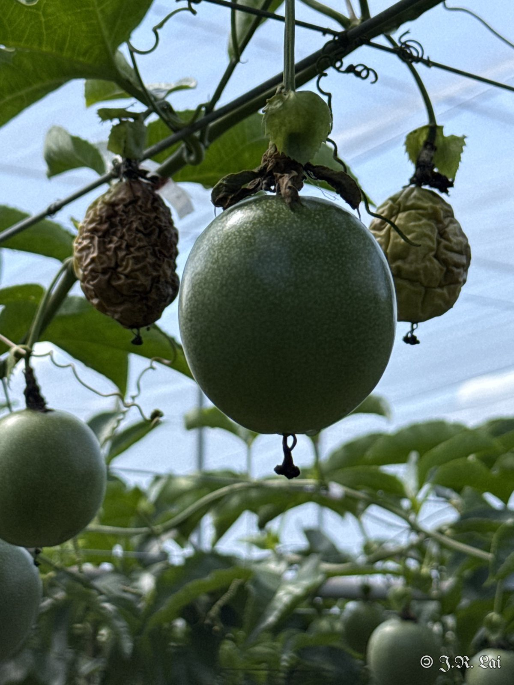<figcaption>高溫障礙：果實乾縮</figcaption></figure>

## 褐斑病

<figure class="photo">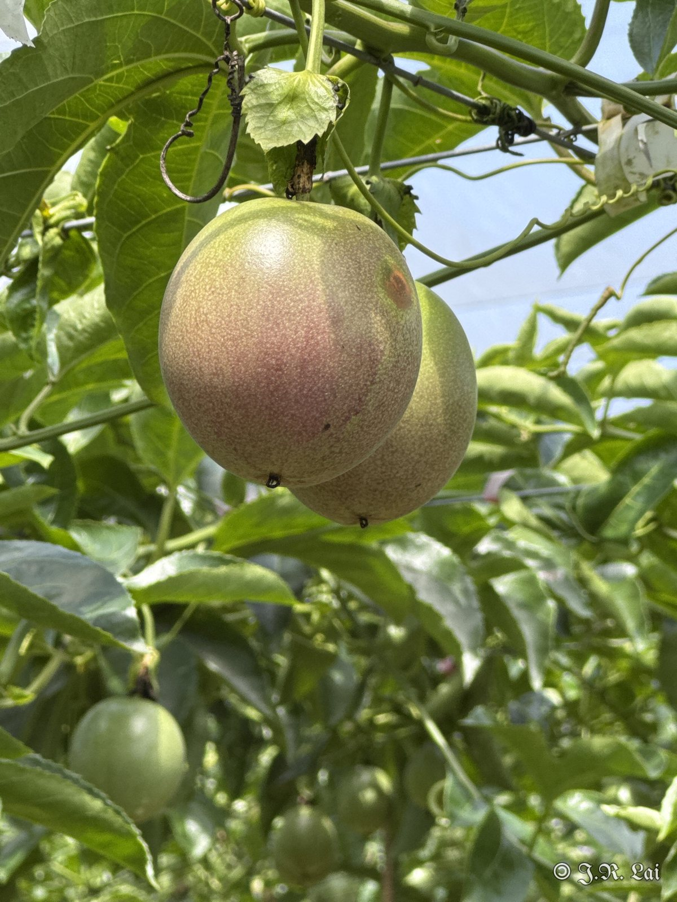<figcaption>褐斑病（<em>Alternaria</em> sp.）</figcaption></figure>

褐斑病病斑周圍會有綠色暈圈，與炭疽病不同，但是病斑初期與炭疽病類似，不易區別。

## 薊馬

<figure class="photo">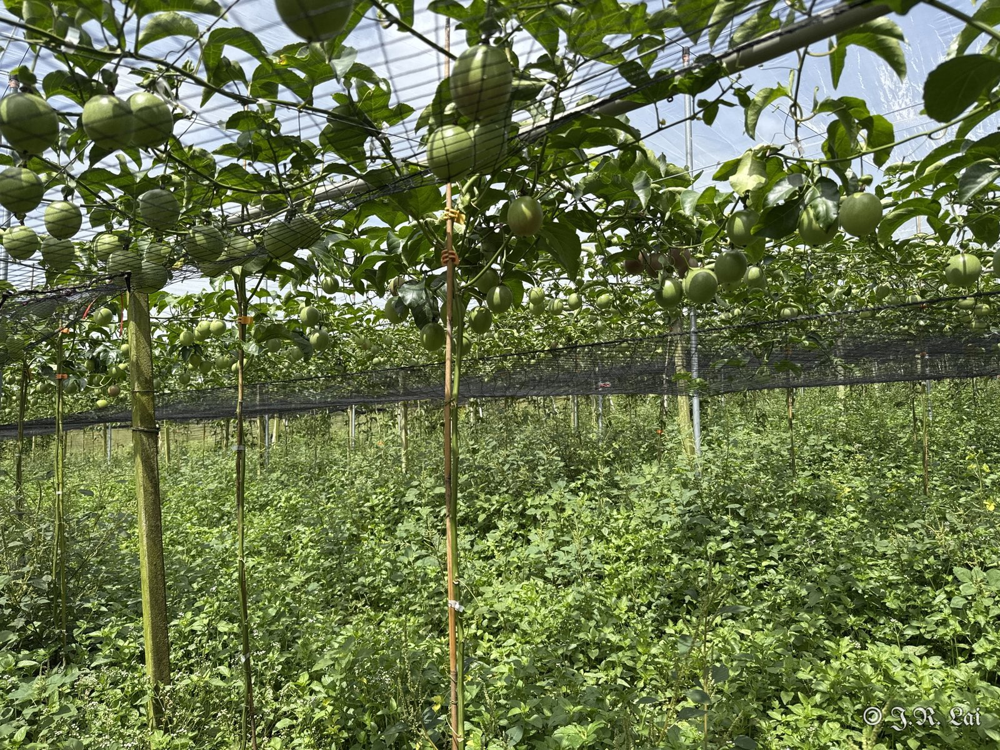<figcaption>臺農一號試驗田</figcaption></figure>
<figure class="photo">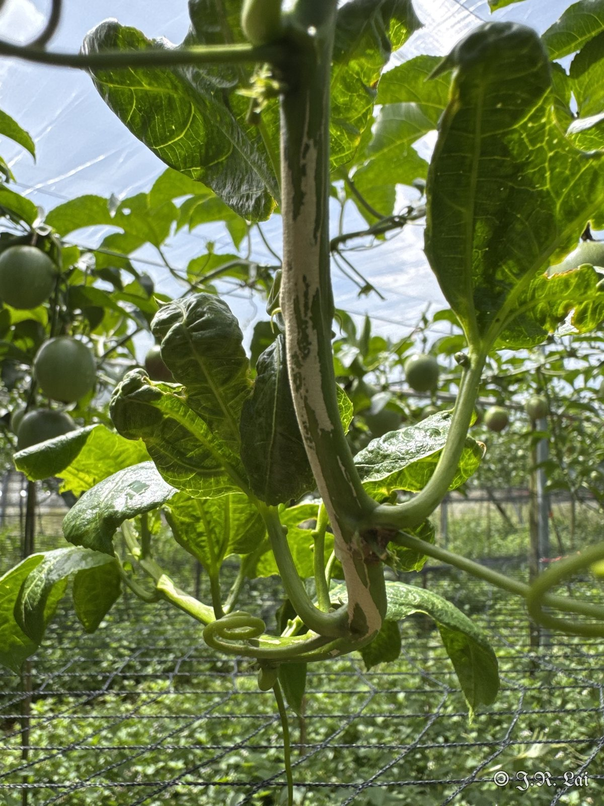<figcaption>薊馬危害新梢</figcaption></figure>
<figure class="photo">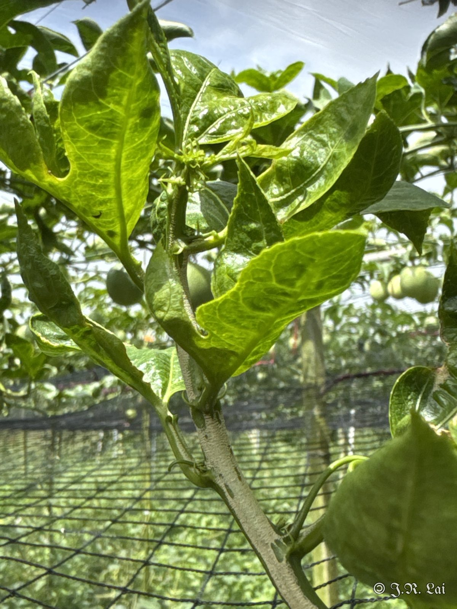<figcaption>薊馬危害新梢</figcaption></figure>

## 疫病

<figure class="photo">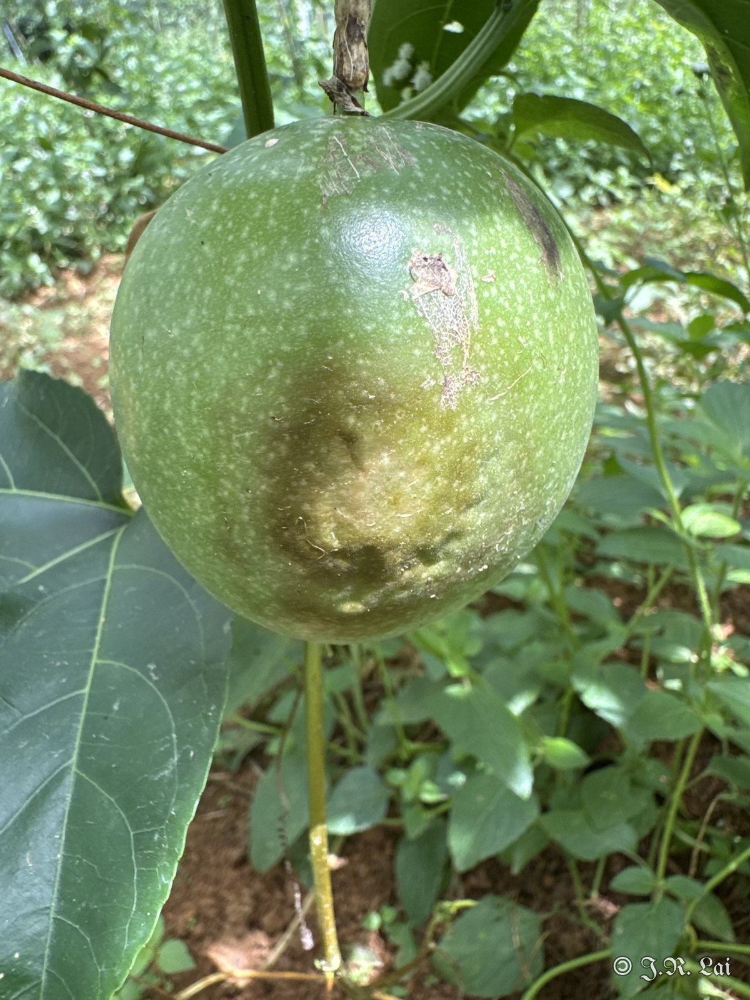<figcaption>疫病</figcaption></figure>

## 炭疽病

<figure class="photo">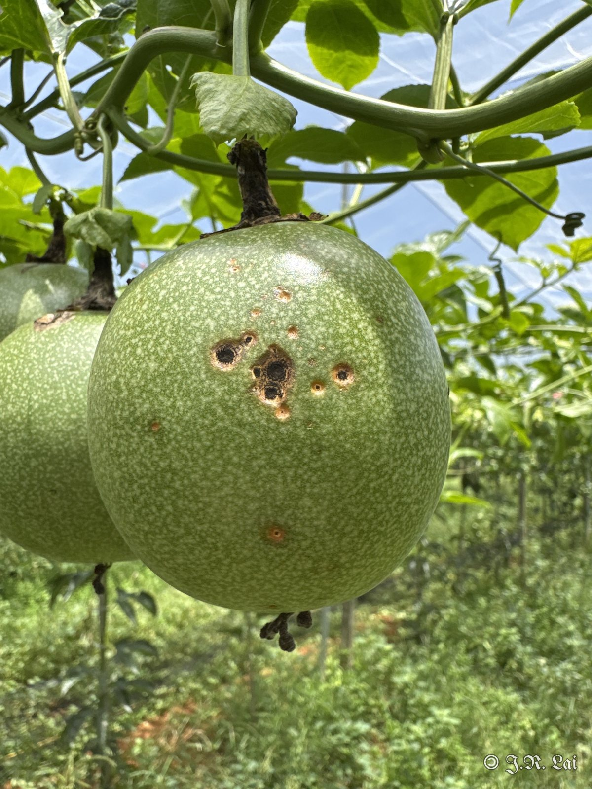<figcaption>果實炭疽病</figcaption></figure>

## 診斷結果

百香果果實蠅危害、高溫障礙、褐斑病、薊馬危害、疫病及炭疽病。

## 建議處理

（待補充）

## 後續追蹤

（待補充）
