<figure class="photo wide">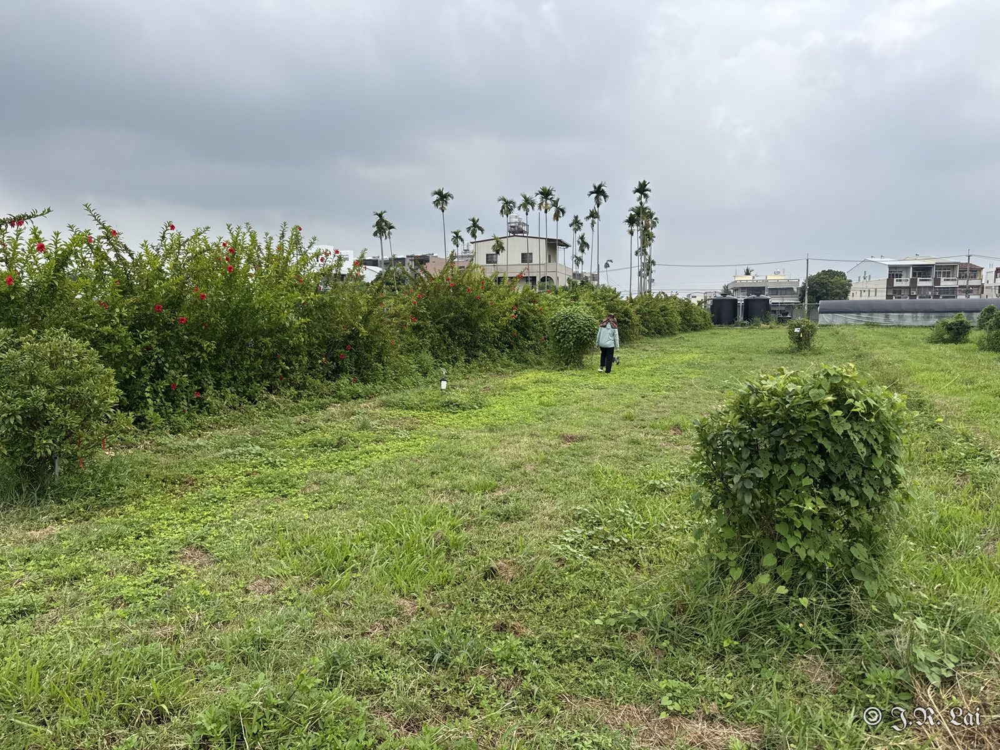<figcaption>圖一、金柑園</figcaption></figure>

## 菲緣椿象

<figure class="photo">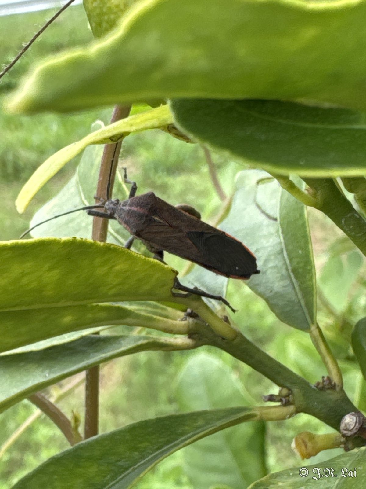<figcaption>菲緣椿象</figcaption></figure>

## 褐圓盾介殼蟲

<figure class="photo">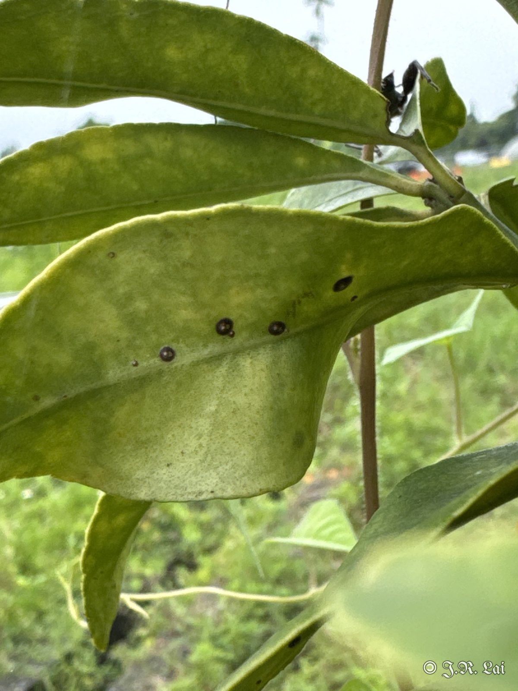<figcaption>褐圓盾介殼蟲</figcaption></figure>
<figure class="photo">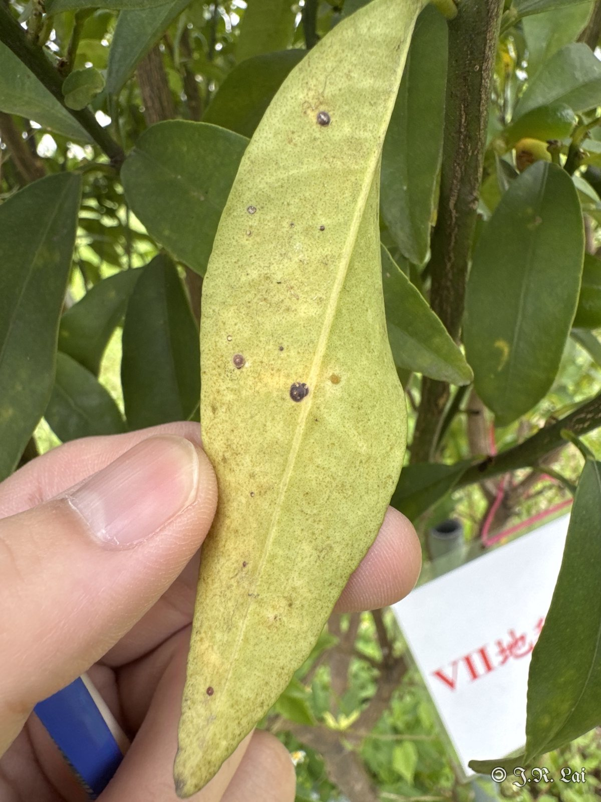<figcaption>褐圓盾介殼蟲</figcaption></figure>

## 柑橘潛葉蛾

<figure class="photo">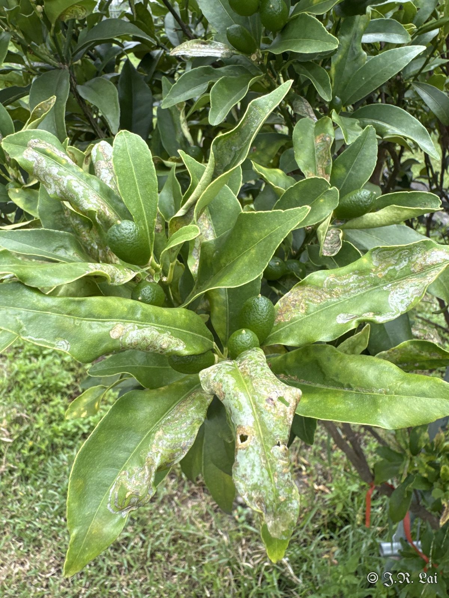<figcaption>柑橘潛葉蛾危害新梢</figcaption></figure>
<figure class="photo">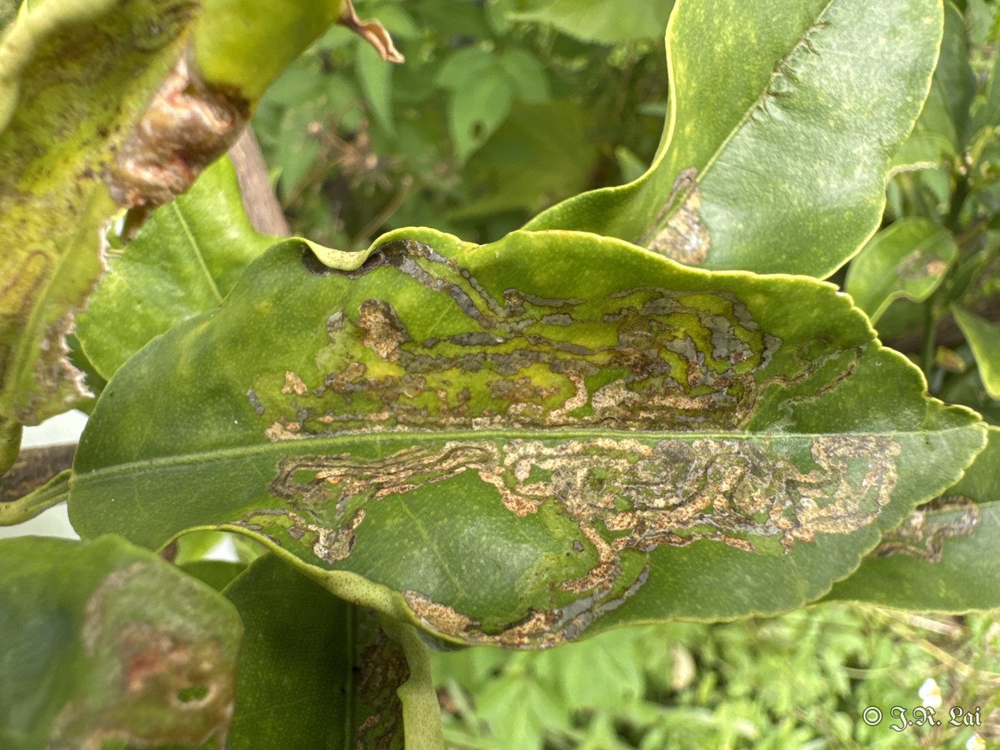<figcaption>柑橘潛葉蛾危害葉片</figcaption></figure>
<figure class="photo">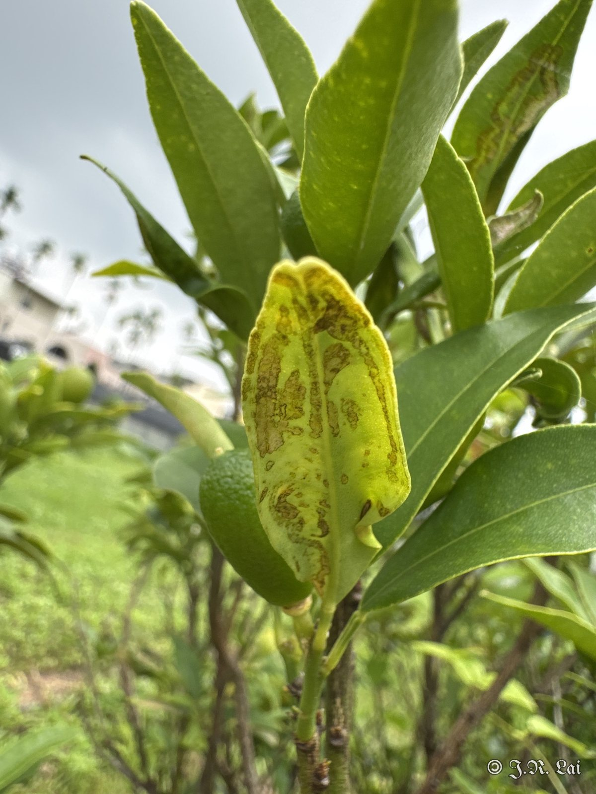<figcaption>柑橘潛葉蛾危害葉片</figcaption></figure>

## 油斑病

<figure class="photo">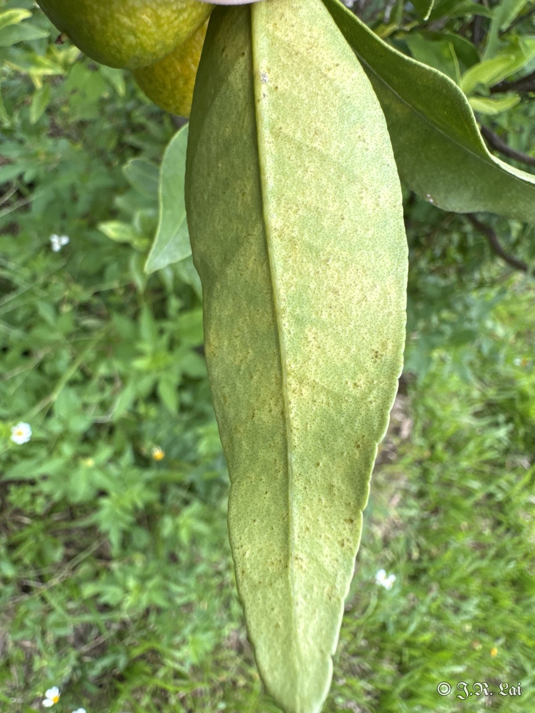<figcaption>油斑病</figcaption></figure>
<figure class="photo">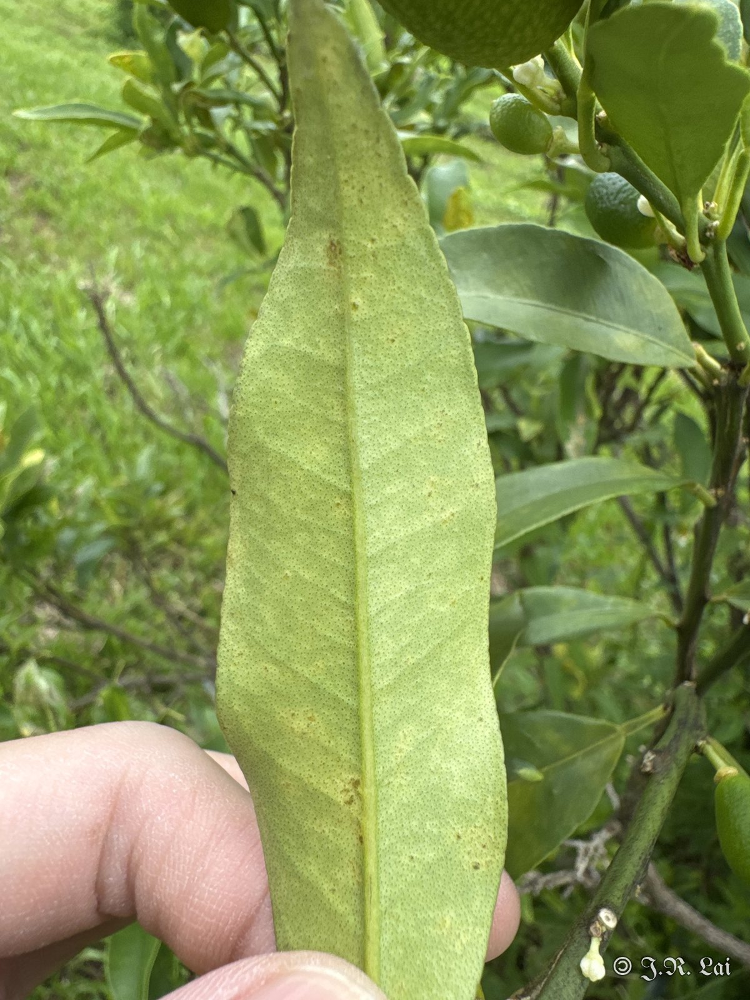<figcaption>油斑病</figcaption></figure>
<figure class="photo">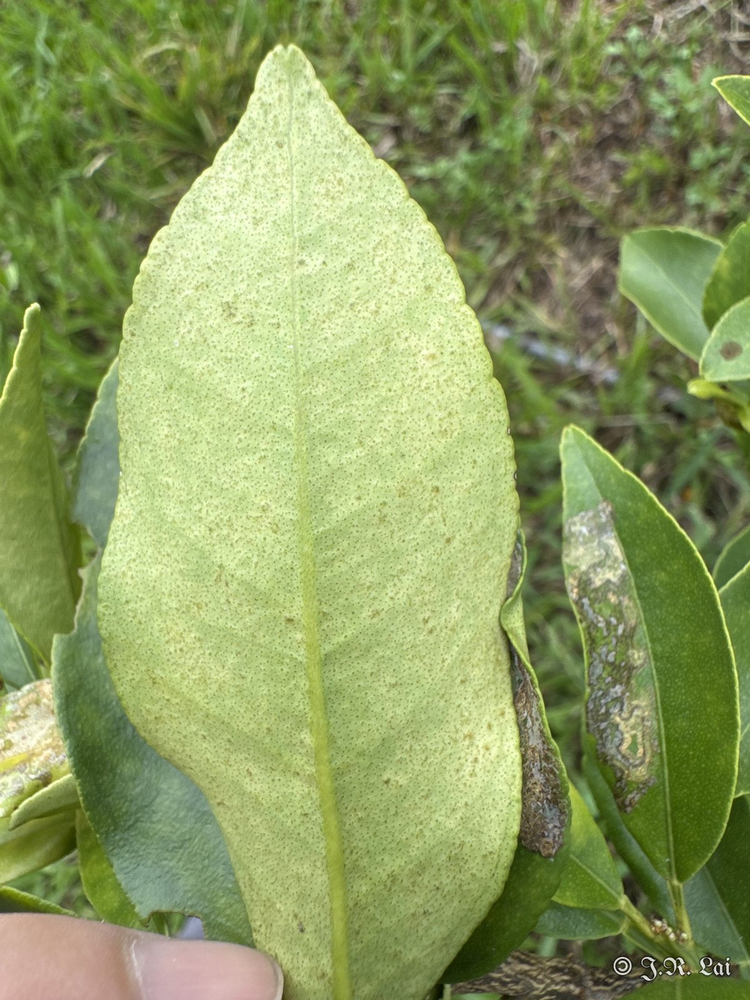<figcaption>油斑病</figcaption></figure>

## 大黑星龜金花蟲

<figure class="photo">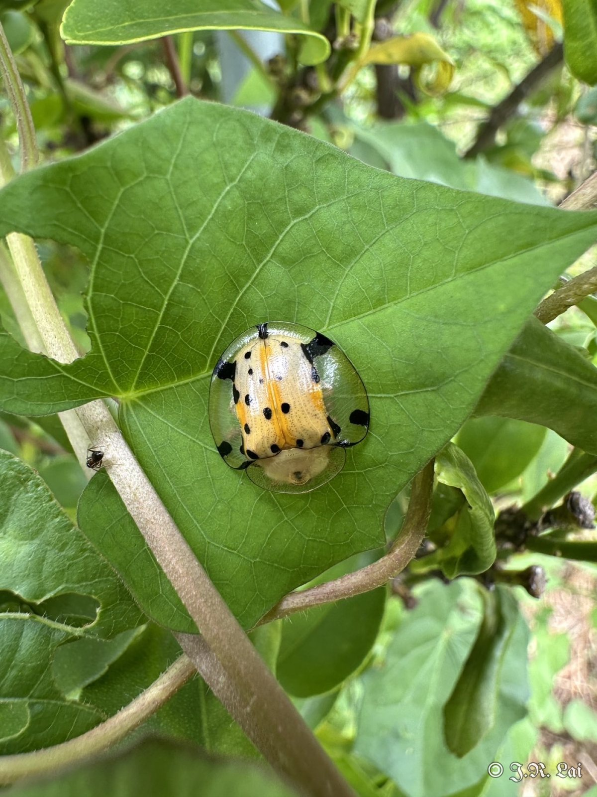<figcaption>有幾棵金柑樹被旋花科雜草包覆，雜草上發現大黑星龜金花蟲</figcaption></figure>

## 診斷結果

金柑菲緣椿象、褐圓盾介殼蟲、柑橘潛葉蛾危害及油斑病；另發現大黑星龜金花蟲。

## 建議處理

（待補充）

## 後續追蹤

（待補充）
