<figure class="photo wide">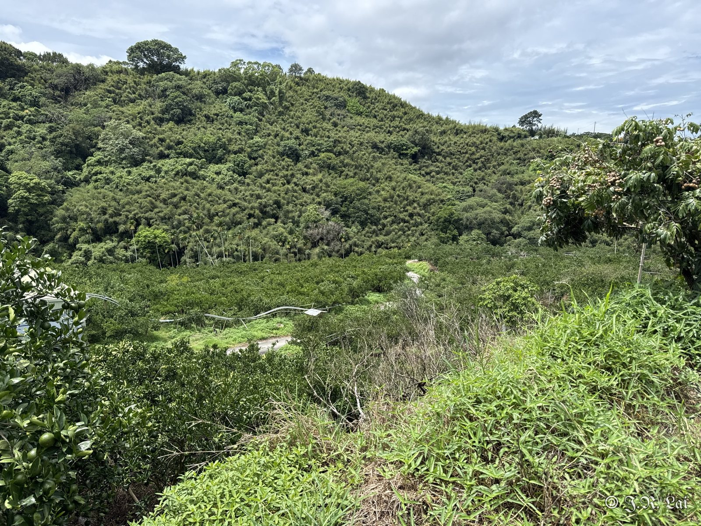<figcaption>圖一　東勢柑橘園</figcaption></figure>

## 椪柑：黑點病

<figure class="photo">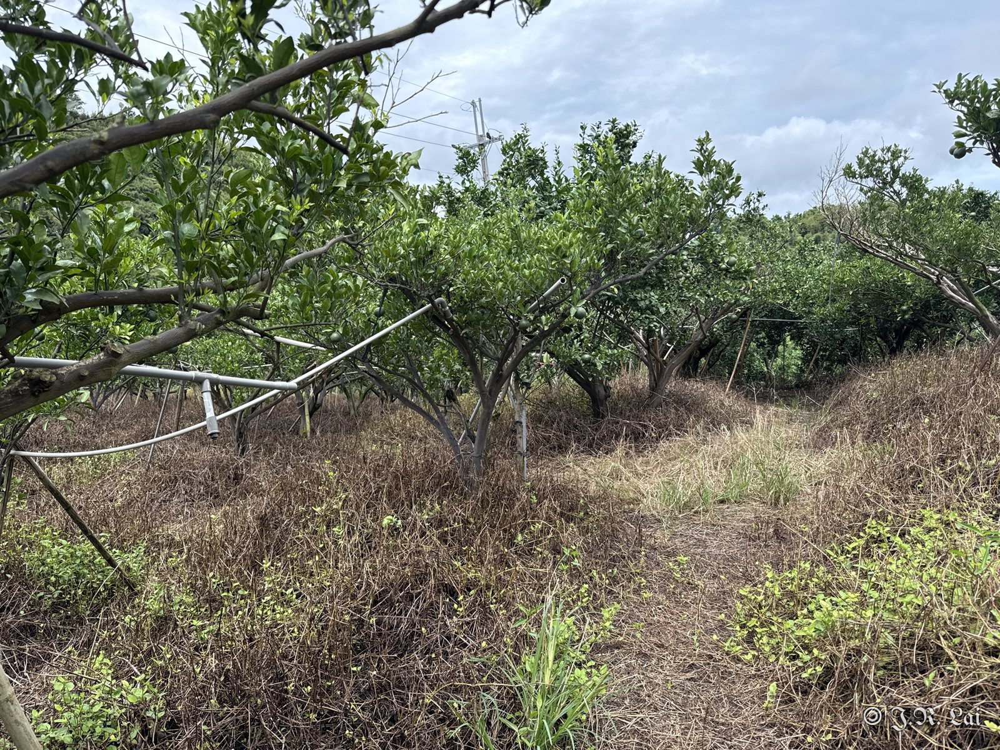<figcaption>椪柑園</figcaption></figure>
<figure class="photo">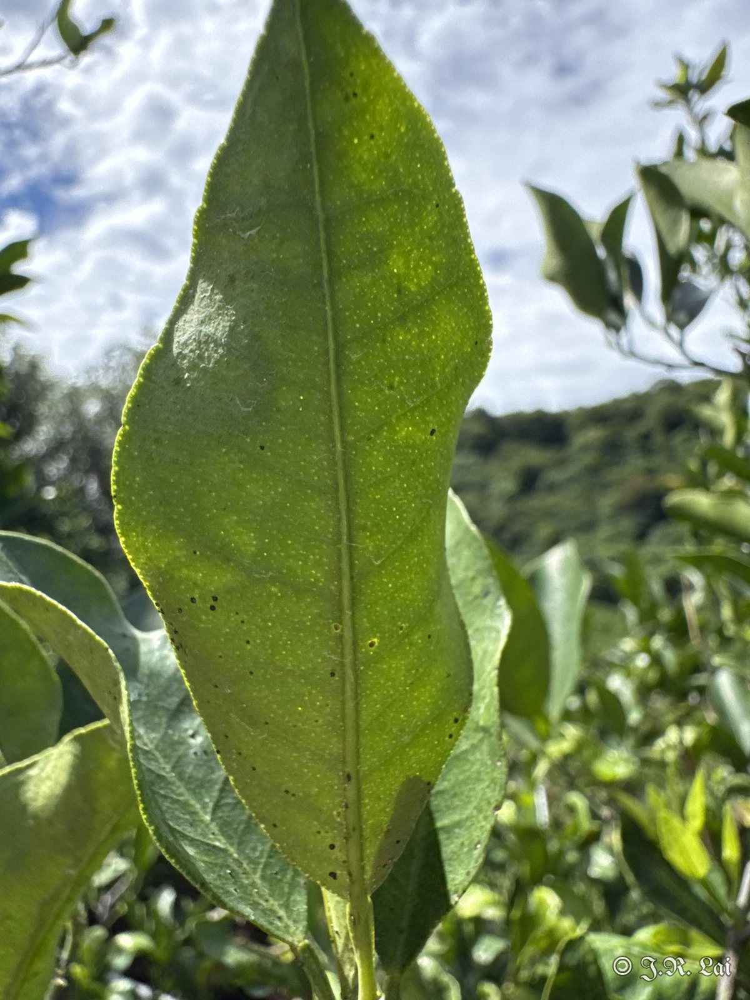<figcaption>葉片黑點病</figcaption></figure>
<figure class="photo">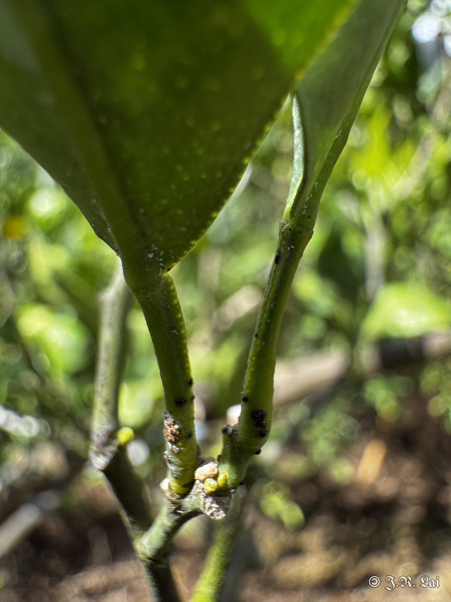<figcaption>枝條黑點病</figcaption></figure>

## 茂谷柑（卓蘭）

<figure class="photo">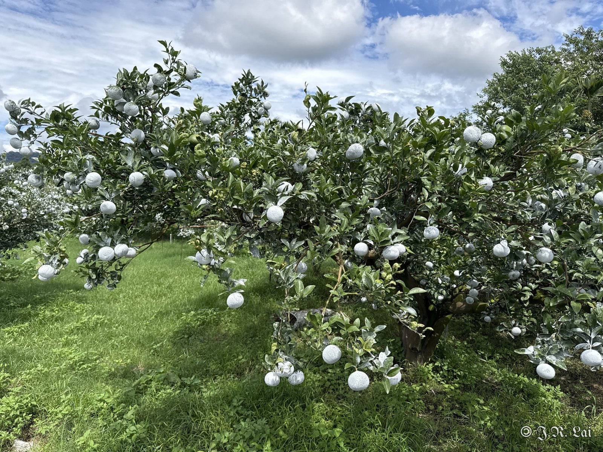<figcaption>茂谷柑園</figcaption></figure>
<figure class="photo">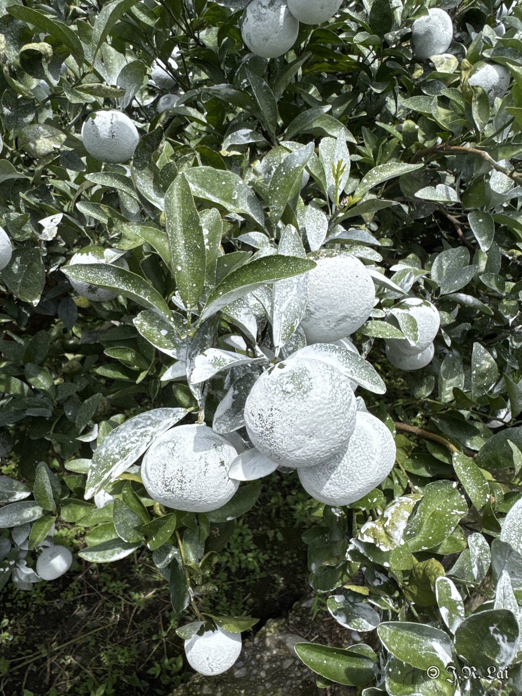<figcaption>單顆噴防日燒</figcaption></figure>

早期為全株柑橘噴碳酸鈣防日燒，但因為會影響光合作用，且用量較高，長期整株噴施易造成落葉，近期改成單點果實噴施，用量少且省成本，但較耗費人力及時間。

### 薊馬危害

<figure class="photo">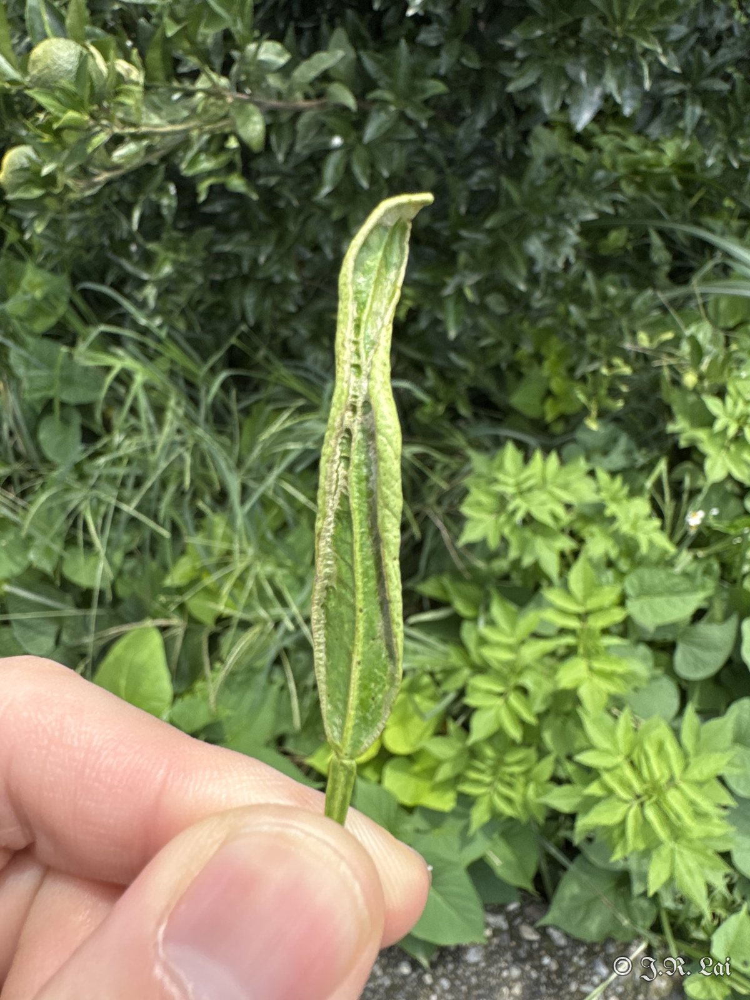<figcaption>新葉薊馬危害</figcaption></figure>
<figure class="photo">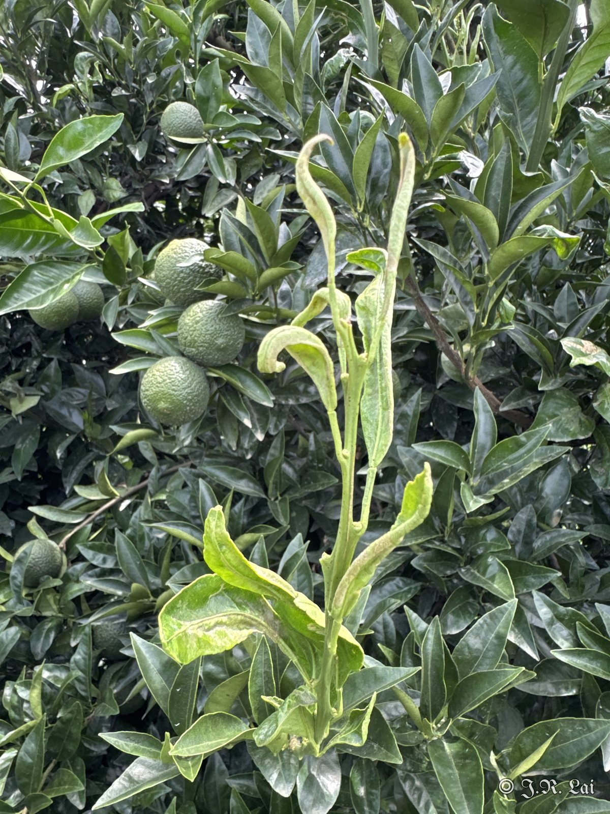<figcaption>新梢葉片捲曲</figcaption></figure>

### 日燒

<figure class="photo">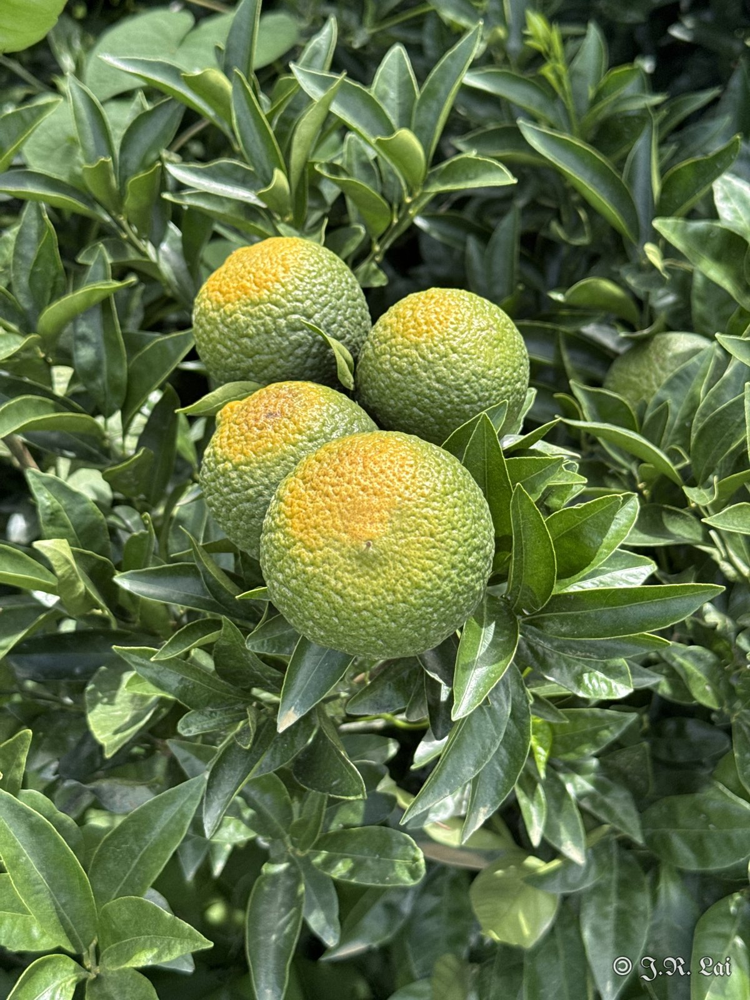<figcaption>果實日燒：向陽面會出現面狀黃化</figcaption></figure>

## 潰瘍病（東勢）

<figure class="photo">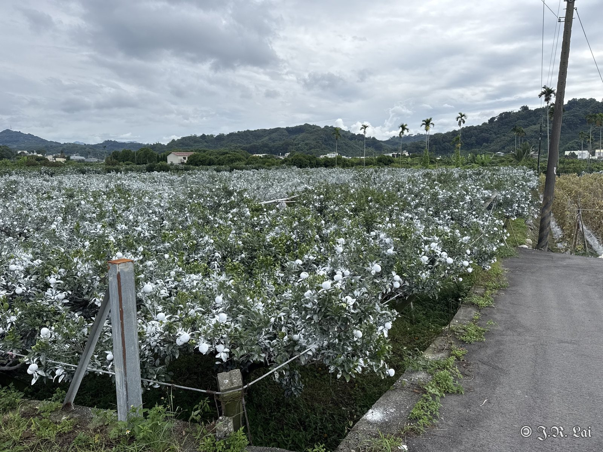<figcaption>柑橘園</figcaption></figure>
<figure class="photo">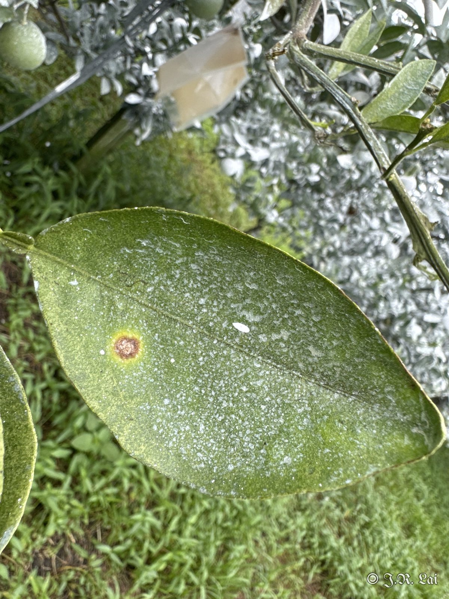<figcaption>葉片潰瘍病斑</figcaption></figure>

## 診斷結果

椪柑黑點病；茂谷柑薊馬危害與日燒；柑橘潰瘍病。

## 建議處理

（待補充）

## 後續追蹤

（待補充）
