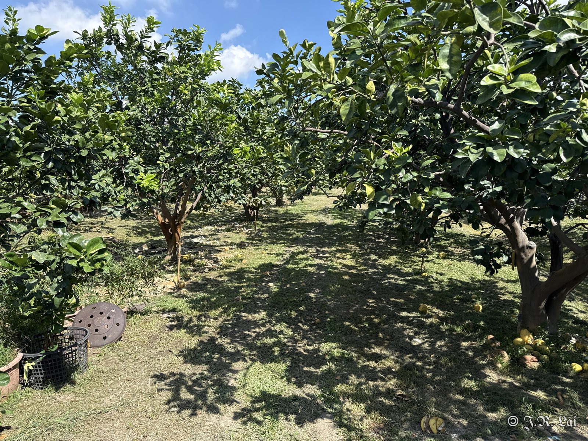
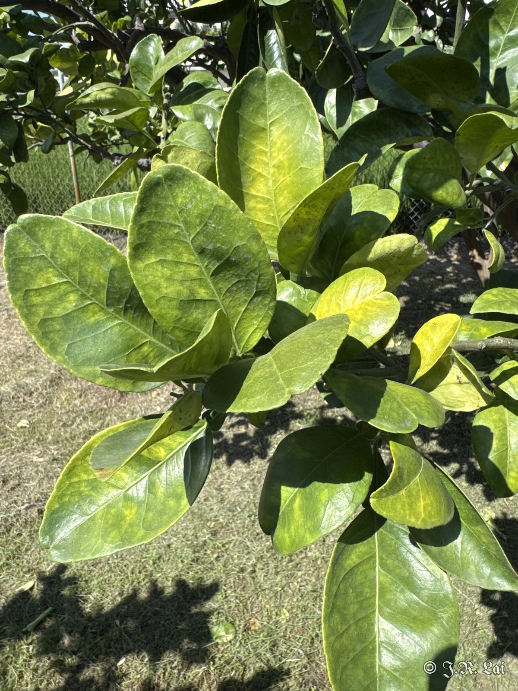
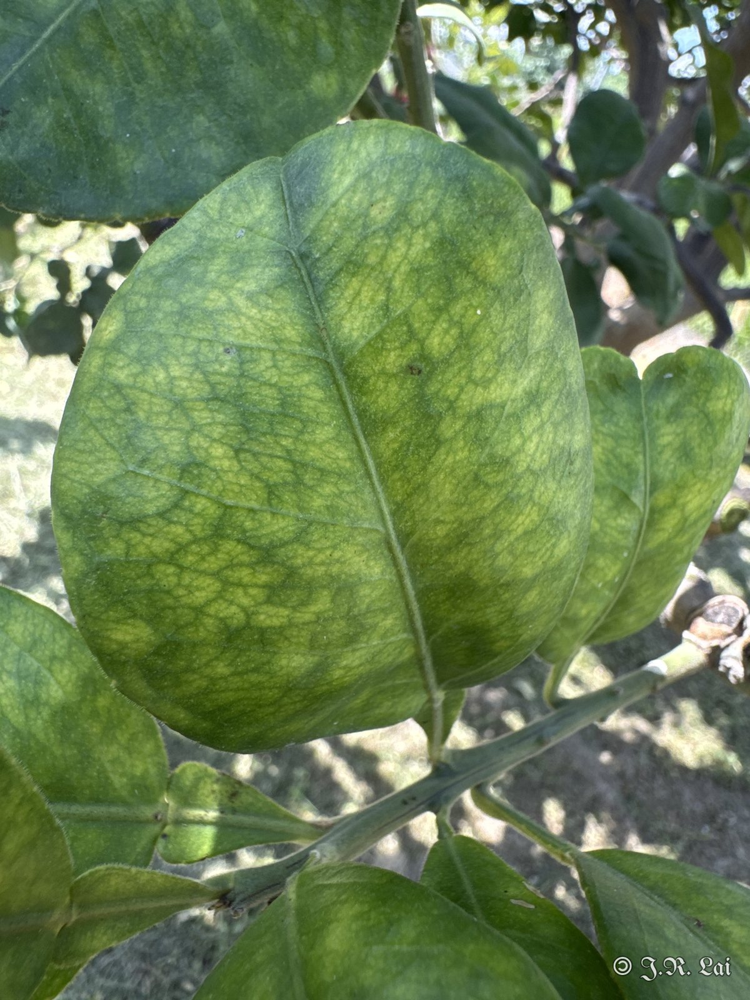
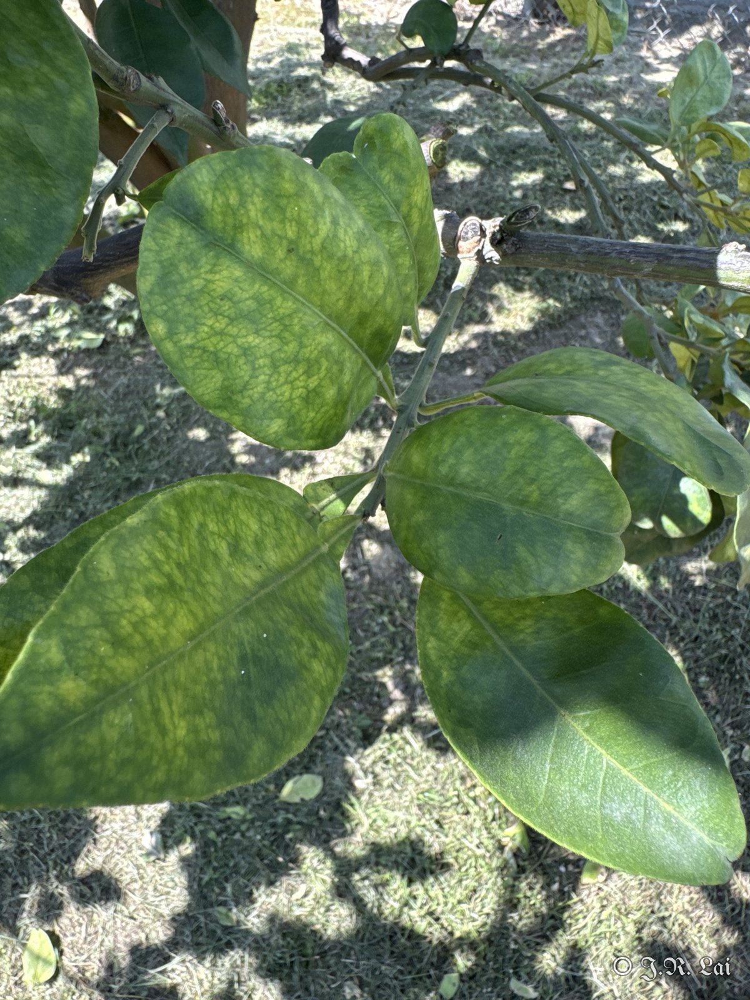
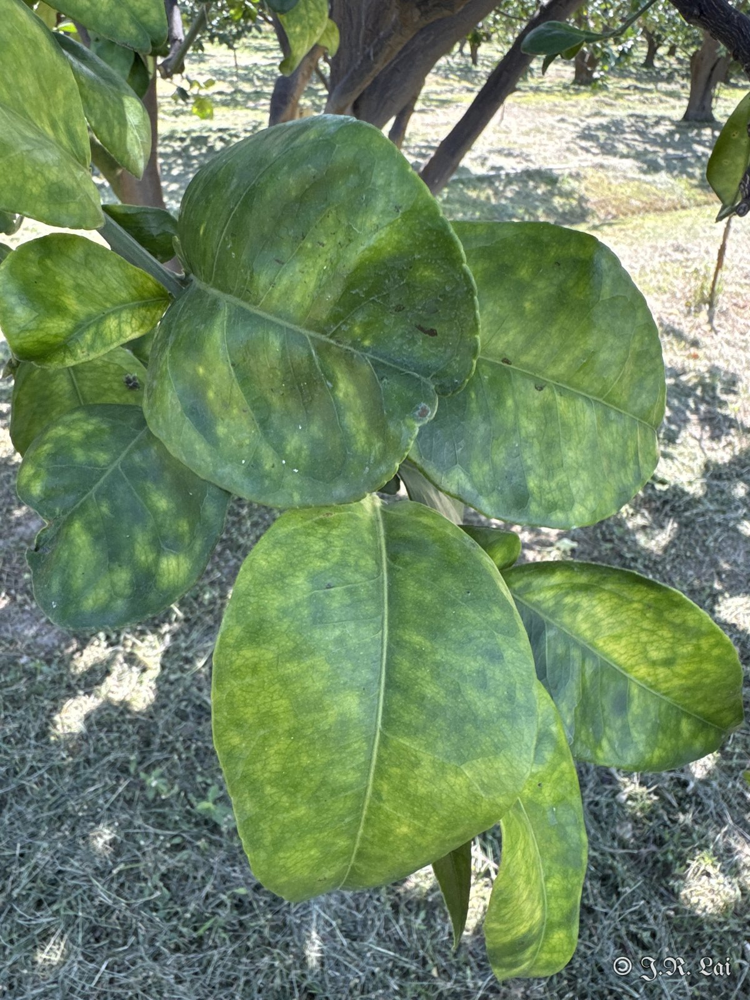
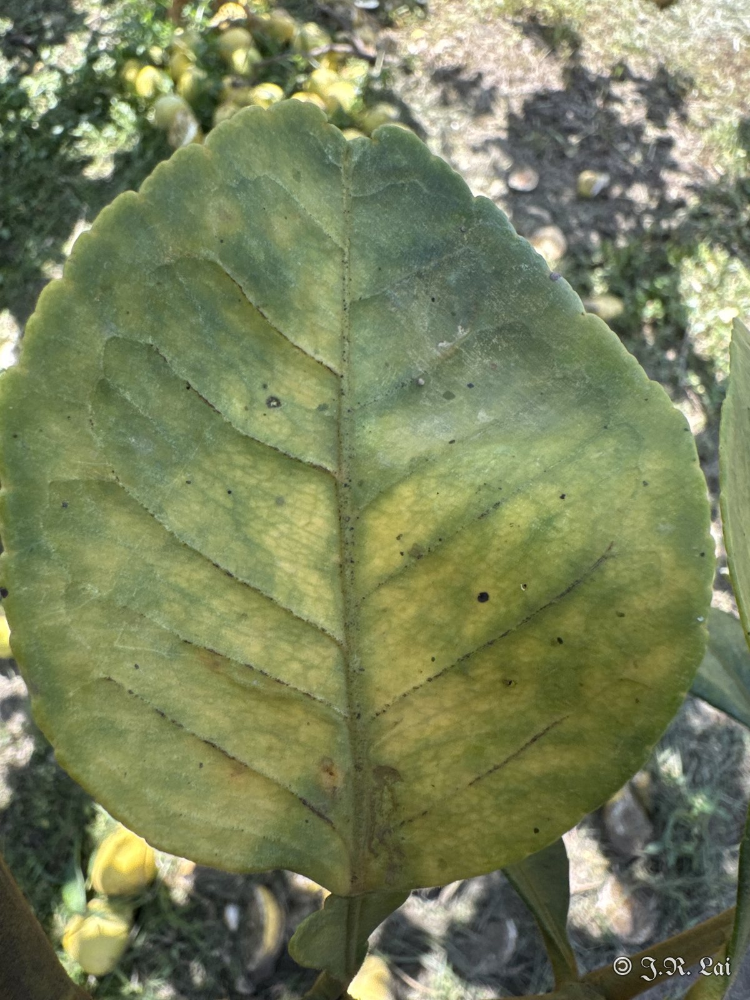
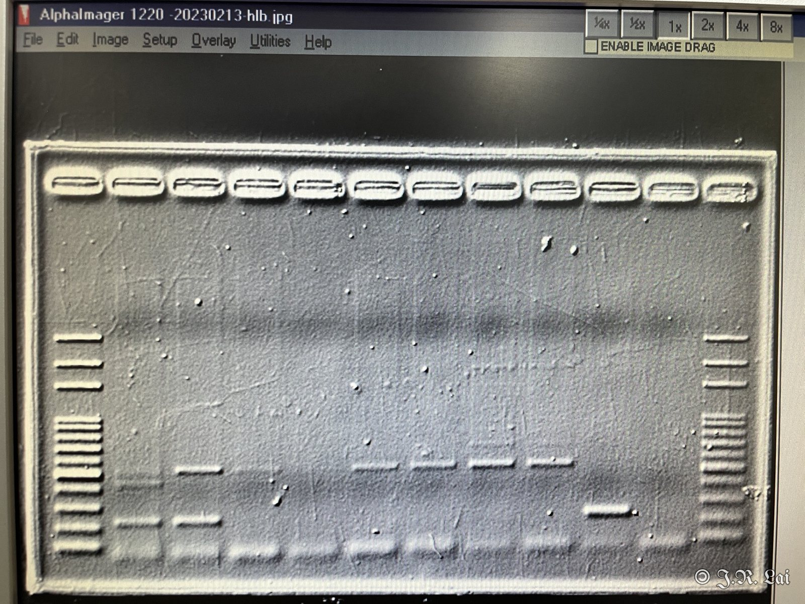
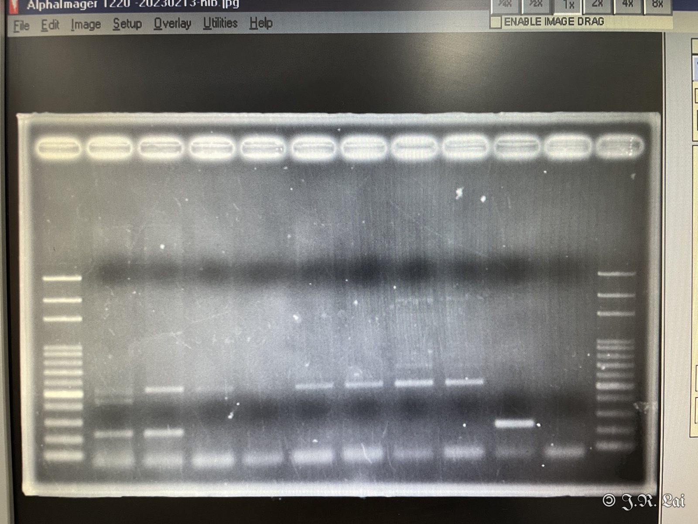

<figure class="photo wide"><figcaption>圖一　果園現場</figcaption></figure>

## 田間病徵

<figure class="photo"><figcaption>葉片黃化</figcaption></figure>
<figure class="photo"><figcaption>葉脈間斑駁</figcaption></figure>
<figure class="photo"><figcaption>葉片斑駁黃化</figcaption></figure>
<figure class="photo"><figcaption>葉片不均勻黃化</figcaption></figure>
<figure class="photo"><figcaption>葉脈木栓化</figcaption></figure>

葉片出現左右不對稱的斑駁黃化，是黃龍病的典型病徵。

## 病原鑑定

黃龍病是由韌皮部細菌 *Candidatus* Liberibacter asiaticus 引起，無法在培養基上分離，需要用 PCR 分子檢測確認。以下是過去檢測的參考照片。

<figure class="photo"><figcaption>柑橘類樣本檢測電泳圖（參考）</figcaption></figure>
<figure class="photo"><figcaption>柑橘類樣本檢測電泳圖（參考）</figcaption></figure>

## 診斷結果

黃龍病（*Candidatus* Liberibacter asiaticus）。

## 建議處理

（待補充）

## 後續追蹤

（待補充）
